# 03 - Entra ID User, Group, and License Administration

## Status

All twelve steps are complete. A Microsoft 365 Business Premium thirty-day trial, started inside the existing tenant with recurring billing off and expiring 2026-10-05, brought Microsoft Entra ID P1; security defaults remained enabled and no conditional access policy was created. The tenant finished at 10 users and 9 groups against a Step One baseline of 10 and 5. Business Premium stood at seven assignment targets against six consumed seats out of 25 enabled, the one-seat gap being a licensed group that holds no members. The only on-premises changes that persist are `department` populated on the six synchronized users and `title` on `mjohnson`.

---

## Overview

Labs 01 and 02 built the hybrid environment. This lab is the first to operate it.

A synchronized user and a cloud-only user look nearly identical in the Entra admin center, and they behave differently under almost every administrative action: editing attributes, changing group membership, assigning licenses, and above all deleting and restoring. The tenant does not label the difference in the places it matters most, so an administrator who does not already know which object is which will make changes that silently fail, or that succeed and are then reverted on the next synchronization cycle.

Group administration splits along the same line. Four of the tenant's five groups arrived from `OU=Groups` and can only be managed on-premises; the fifth was born in the cloud. Everything this lab creates is necessarily cloud-only, including the environment's first dynamic membership group.

License administration is where the two halves meet, and it is the first capability in this track bounded by entitlement rather than by configuration. This lab starts a Microsoft 365 Business Premium trial inside the existing tenant, verifies what the trial actually granted rather than what its name implies, and then spends thirty days using it. It does not gain conditional access, which stays with Lab 05.

---

## Objectives

The primary goals of this lab are to:

- resolve the Business Basic trial question the track deferred, start a Microsoft 365 Business Premium trial from inside the existing tenant as a documented step, protect the tenant from that trial's automatic conversion on the same day, and record the resulting licensing state as observed
- establish what can and cannot be edited on a synchronized object compared with a cloud-only one, including the error text Microsoft Entra returns when an on-premises-mastered attribute is written in the cloud
- catalogue the tenant's groups by type, membership model, and source of authority, including the origin, type, and membership governance of the pre-existing cloud-only `All Company` group
- create the environment's first cloud-only assigned security group and Microsoft 365 group, and compare their administrative surface with the four groups synchronized from `OU=Groups`
- populate an organizational attribute on the synchronized users and build a dynamic membership group whose rule evaluates against it, documenting the rule behavior across the synchronization boundary and the security consideration Microsoft raises about rules on synchronized attributes
- document direct per-user assignment and group-based licensing, including the documented order for moving a user between licensed groups and at least one deliberately induced license assignment error
- assign a built-in Microsoft Entra directory role at tenant scope and, separately, to a role-assignable group, and record which of the tenant's existing groups are eligible to hold a role assignment
- delete and restore both a synchronized user and a cloud-only user, including what the synchronization engine does about a synchronized user deleted only in the cloud
- delete and restore a cloud-only security group and a cloud-only Microsoft 365 group, and settle the contradiction between Microsoft's Entra PowerShell reference and its recoverability architecture guidance over whether a cloud-only security group can be restored at all
- confirm that host and service configuration on DC01, WIN11-CLIENT01, Ubuntu Server, and `SYNC01` is unchanged by this lab, and that its on-premises directory changes are only the deliberate ones
- settle the `AZUREADSSOACC` key rollover obligation Lab 02 left open: whether thirty days is a hard clock or a hygiene recommendation, and the account's actual state

---

## Project Context

[ADR-019](../architecture/decisions/019-establish-cloud-and-hybrid-identity-track.md) established this track and settled its architecture, and nothing in this lab reopens any of it. The synchronization engine, its scope, its authentication method, and the tenant's administrative model are all as Lab 02 left them and are not touched here.

Labs 01 and 02 were both construction labs, and neither asked what the resulting environment is like to operate. A hybrid tenant's defining operational property is that every object in it has a source of authority, and the source is not the same for every object. Lab 02 already produced a preview of the consequences: the `IT-Admins` group has four members on-premises and three in the tenant, because `labadmin` sits in the deliberately unsynchronized `OU=IT`. The group looks complete in the Entra admin center and is not.

The lab also carries the track's first licensing action. ADR-019 Design Decision 2 states that the identity foundation sits on Microsoft Entra ID Free and that capabilities above that tier are licensed as the labs that need them arrive. Dynamic membership groups and role-assignable groups both sit above the free tier, so acting on it here executes the decision ADR-019 already made and needs no new ADR.

The track README's Licensing section left keeping, cancelling, or replacing the Business Basic trial as a decision for before Lab 04. Recurring billing on the Basic trial has been disabled, so it lapses on 2026-09-22 rather than converting, and Business Premium is taken as a trial rather than a purchase.

Lab 04 depends directly on the outcome: the licensed population this lab establishes is the population Lab 04 gives mailboxes to. Lab 05 depends on it for conditional access and device enrollment. Both inherit the thirty-day window this lab opens, and what to do when it closes is a decision each of them takes for itself.

---

## Design Decisions

### The subscription decision is taken in this lab, and the decision is to trial rather than buy

**Decision:** A Microsoft 365 Business Premium thirty-day trial is started from inside the existing tenant. Nothing is purchased.

The track README scheduled this decision for "before Lab 04," but Lab 03's own scope needs a paid tier as well: dynamic membership groups and role-assignable groups both require Microsoft Entra ID P1, and both are named in this lab's scope in the track README and in ADR-019's track scope.

Business Premium rather than a standalone Entra ID P1 add-on, because the remaining labs need more than P1. Business Premium includes Microsoft Entra ID P1, Microsoft Intune Plan 1, Exchange Online Plan 1, Microsoft Defender for Business, and Microsoft Defender for Office 365 Plan 1. That covers this lab's P1 features, Lab 04's mailboxes, and Lab 05's conditional access and device enrollment in one subscription, and it is the only single small-business subscription that does.

Trial rather than purchase. Business Premium is sold on two lines: $22.00 per user per month on annual commitment with Teams and $18.79 without, both confirmed on 2026-09-04 and 2026-09-05 rather than treated as standing prices, with the pricing page also steering toward a $32.00 Copilot variant. Which line the trial lands on is settled at Step Two. Five seats committed for a year is $1,320.00 on the with-Teams line or $1,127.40 on the no-Teams line, to demonstrate group and license administration in a lab environment with nine on-premises users, none of whom are real people. Business Basic's $6.48 figure that Lab 01 recorded is the current no-Teams monthly list price, observed seven weeks after Microsoft's 2026-07-01 pricing update took effect, which places Lab 01's baseline after that increase. That is not a defensible spend on either line.

Buying would also pay for the wrong thing: this track needs to operate these capabilities, not keep them, and what the document holds is the observed behavior of a real system at a recorded date, which survives the lapse. The cost a trial does carry is a deadline, handled by sequencing below.

### Starting the trial is a documented step, not an off-camera prerequisite

**Decision:** The trial is started in Step Two of the Implementation section below, performed and screenshotted in sequence like any other configuration action, and the resulting licensing state is read back from the tenant in Step Four.

Lab 01 recorded that security defaults covered "administrative multifactor authentication," and Lab 02 Step Seven found that security defaults has no administrator scoping at all: an ordinary synchronized user was required to register Microsoft Authenticator at first cloud sign-in, because the feature is tenant-wide. A subscription invites the same error. "Business Premium includes Entra ID P1" is true and is not the same claim as "every capability this lab needs is now available to every account that needs it." Step Four closes that gap: what service plans the trial contains, how many licenses it granted, what the Entra admin center reports as the tenant's Microsoft Entra plan, and whether anything changed that this lab did not ask for.

### Whether this tenant can start a second trial at all is a finding, not an assumption

**Decision:** Step Two records what the portal actually allowed, including a refusal, rather than treating the trial's availability as given.

The trial is started from inside the existing tenant through Billing, Add more products, so that it lands in the same organization as the verified `brindeck.com` domain and the synchronized population rather than creating a second tenant. Nothing found during planning documents whether a tenant that has already consumed a Business Basic trial can start a Business Premium trial. Trial eligibility is generally per product, which suggests it should, but this track has a standing preference for observing over inferring. If the trial is refused, the refusal and its exact wording are recorded and the lab stops for a decision, because every alternative at that point is either a purchase or a second tenant.

### Recurring billing is disabled on the day the trial starts

**Decision:** Turning off recurring billing on the Business Premium trial is Step Three, performed in the same sitting as Step Two, and recorded as an action rather than mentioned as a caveat.

Microsoft's documentation is explicit that a trial subscription converts to a paid subscription at the end of the trial period unless recurring billing is turned off, and that turning it off causes the trial to expire at the end of its month with no charge. The Basic trial in this tenant has already been through this: its recurring billing was disabled deliberately so that it lapses on 2026-09-22 instead of converting. An operational trap that costs money if missed gets its own step rather than a footnote inside Step Two, and Step Three also confirms the Basic trial's state from the Billing pages in the same place.

### The lab is sequenced against a thirty-day clock

**Decision:** Every step that depends on the trial's entitlements is placed ahead of every step that does not, so that the perishable work is complete before the window closes.

Steps Six, Seven, and Eight need Microsoft Entra ID P1 specifically, for dynamic membership groups, role-assignable groups, and group-based licensing, and cannot be attempted at all without it. Steps Five, Nine, and Ten need live licenses on live accounts: Step Five is where those licenses get assigned, and Steps Nine and Ten document whether a restored user comes back holding the licenses it had, and what happens to a group that carries a group-based license assignment when it is deleted.

Only Step Eleven is tier-independent among the content steps. What can and cannot be edited on a synchronized object is a function of source of authority rather than of licensing, and it behaves identically on Entra ID Free. So it is placed last among the content steps, where a slip costs nothing, and Step Twelve's validation follows it. This is the reverse of the order the objectives are listed in, and is deliberate.

### Acquiring P1 in this lab does not turn on conditional access

**Decision:** This lab uses only P1's group and licensing capabilities. Security defaults remains enabled and untouched, and no conditional access policy is created, modified, or evaluated.

ADR-019 Design Decision 6 gives the security defaults to conditional access transition to the lab that introduces conditional access, and requires that lab to reproduce the protections being removed rather than dropping them silently. Lab 05 is that lab. Acquiring the entitlement that makes conditional access available is not the same event as taking on the obligation that comes with using it, and collapsing the two would put the tenant's only multifactor authentication enforcement inside a lab about groups and licenses.

The one consequence this lab does record is that security defaults is still on and still tenant-wide, so any account licensed here that has not signed in to a cloud service before will be required to register a multifactor authentication method at first sign-in, exactly as the synchronized user in Lab 02 Step Seven was.

### Delete and restore is content, not a boundary note

**Decision:** The synchronized-versus-cloud-only comparison is built on delete and restore behavior as well as attribute editing, with `cloudonly-demo01` as the cloud-only subject.

Attribute editing answers the question narrowly, in one step. Deletion answers it the way an administrator actually meets it, because "someone deleted a user, can we get them back" is a helpdesk ticket rather than a documentation exercise, and because the two object types genuinely diverge:

- A cloud-only user deleted in the tenant is soft-deleted for thirty days with all properties preserved, including group memberships, roles, and licenses, and is restored from Deleted users.
- A synchronized user deleted in the tenant is soft-deleted the same way, but Microsoft Entra is not its source of authority. If the object still exists in Active Directory, the next synchronization cycle may restore it without anybody restoring it deliberately, on the same half-hourly Delta cycle Lab 02 Step Nine had to fix before it ran unattended at all.
- A user deleted more than thirty days ago is not restorable at all, by anyone, including Microsoft support, and the hybrid match path is blocked along with the manual one.
- Restoring a user restores the licenses it held at deletion even when none are free, which is a compliance state a tenant can reach without noticing.

`cloudonly-demo01` exists for this. Lab 02 Step Nine kept it deliberately, renamed from `duptest03`, because the tenant's only other cloud-only accounts are all Global Administrator tier and none of them can safely be deleted to see what happens.

There is also a documentation conflict to settle. Microsoft's Entra PowerShell reference states that only Microsoft 365 groups can be restored and that security groups cannot. Microsoft's recoverability architecture guidance states that soft-deleted Microsoft 365 groups and cloud security groups both appear on the Deleted groups page and both restore, with named exceptions that do not apply to this tenant. This lab tests it against the tenant and records what the tenant did, as Lab 02 did when `Get-EntraDirSyncFeature`'s accepted feature name did not match Microsoft's own documentation.

### The dynamic membership rule is scoped to a real attribute

**Decision:** An organizational attribute is populated on the synchronized users on-premises first, and the dynamic membership rule is keyed to that. The rule matches a subset of the users rather than all of them.

[Automation Lab 02](../automation-and-scripting/02-group-and-ou-administration.md) recorded that this domain has no populated `Department`, `Title`, or `Manager` attributes, and `New-LabUser.ps1` sets none of them either. A dynamic membership rule keyed to any of them would match nothing, and a rule keyed to something every user carries, `userPrincipalName` or `accountEnabled`, produces a group indistinguishable from a static list of everyone that cannot be shown reacting to anything. Populating the attribute lets the lab set a value on-premises, wait one synchronization cycle, and watch Microsoft Entra ID move a user into or out of a group nobody touched, exercising the Delta cycle Lab 02 had to repair before it ran unattended at all.

The script gap stays out of scope. `New-LabUser.ps1` will keep creating accounts with no organizational attributes, so any account it creates lands outside whatever rule this lab writes. That is a defect in the automation library, the same shape as the `Get-LabWazuhAgentStatus.ps1` agent-list gap already carried forward, and it belongs to Lab 06 under the ADR-017 analysis and testing standard.

The specific attribute is chosen and confirmed during implementation. Microsoft's guidance on the choice is a security consideration: the security of a dynamic group's membership is only as strong as the write permissions on the attributes its rule references, and attributes synchronized from Active Directory may carry SELF write permissions that let users modify their own values. That check is part of Step Six.

### Mail-enabled security groups and distribution lists are named as a boundary and handed to Lab 04

**Decision:** This lab identifies mail-enabled security groups and distribution lists as a group type it does not create or manage, states why, and hands them to Lab 04. Nothing is built.

Microsoft is explicit that distribution lists and mail-enabled security groups can only be managed in the Exchange admin center or the Microsoft 365 admin center, not in the Entra admin center. Leaving that unstated would misrepresent the catalogue as complete. But they are mail objects, their administration lives in a console this lab otherwise never opens, and Lab 04 already has distribution and Microsoft 365 group management in its scope.

### Administrative units are a boundary handed to Lab 05

**Decision:** Administrative units are named as a scoping mechanism this lab does not use, with the reason recorded, and handed to Lab 05.

The reason is scope, not entitlement. Creating administrative units requires only a free license, and the P1 that scoped role assignment and dynamic administrative unit membership require is present for the duration of the trial. But this lab already carries the widest surface in the track, and administrative-unit-scoped role assignment sits naturally with Lab 05's access control theme. The on-premises organizational unit structure this track synchronizes by is exactly the kind of division an administrative unit expresses in the cloud, which argues for giving them proper attention rather than a shallow treatment here.

---

## Technologies Used

- Microsoft Entra admin center: users, groups, deleted users, deleted groups, roles and administrators
- Microsoft 365 admin center: Billing, Add more products, Your products, Licenses, and the group-based licensing pages, which is where user and group license assignment now lives rather than in the Entra admin center
- Microsoft 365 Business Premium, on a thirty-day trial, providing Microsoft Entra ID P1
- Microsoft Entra Connect Sync on `SYNC01`, unchanged, as the mechanism whose cycle several of this lab's observations depend on, and as the host of the Seamless SSO PowerShell module if the `AZUREADSSOACC` key is rolled
- Active Directory Users and Computers and the Track 3 PowerShell library on WIN11-CLIENT01, for the on-premises half of each comparison
- Microsoft Graph PowerShell SDK, read-only in this lab, for reading object properties and license state that the portal summarizes rather than shows. No script is produced here; scripting the hybrid boundary is Lab 06's work under [ADR-017](../architecture/decisions/017-adopt-powershell-static-analysis-and-unit-testing.md)

---

## Architecture or Topology

Nothing is deployed by this lab and no topology changes. What changes is the tenant's licensing state and its object population, and the useful diagram is of authority rather than of infrastructure.

```text
Active Directory (corp.home.arpa, DC01)          Microsoft Entra ID (Brindeck)
--------------------------------------          -----------------------------
OU=User Accounts  ─── Entra Connect Sync ──────▶ 6 synchronized users
OU=Groups         ─── (SYNC01, Delta 30m) ─────▶ 4 synchronized groups
OU=IT             ─── deliberately excluded       (labadmin absent by design)
OU=Service Accounts, OU=Protected Objects,
OU=Workstations   ─── out of scope

                                                 3 cloud-only admin accounts
                                                 1 cloud-only demo account
                                                 1 cloud-only group (All Company)
                                                 + everything this lab creates,
                                                   which is necessarily cloud-only
```

The single fact that organizes the whole lab is that the arrow points one way. An object that arrived along it is administered at its origin; an object that did not exist before it reached the tenant is administered in the tenant. Every "can I edit this" question in this lab resolves to which side of that arrow the object came from, and the tenant does not make the distinction obvious in its own interface.

---

## Prerequisites

Carried forward and required to be operational:

- Lab 01 and Lab 02 complete, with the tenant holding a verified primary custom domain `brindeck.com`, three cloud-only administrative accounts, and security defaults enabled
- Entra Connect Sync 2.6.84.0 on `SYNC01`, scoped to `OU=User Accounts` and `OU=Groups`, with the scheduler confirmed running unattended on a thirty-minute Delta cycle since Lab 02 Step Nine
- DC01, WIN11-CLIENT01, and Ubuntu Server operating as the Linux, enterprise, and automation tracks documented, with all four Wazuh agents active
- `cloudonly-demo01@brindeck.com`, the cloud-only fixture Lab 02 Step Nine kept for this lab
- The Business Basic trial with recurring billing already disabled, so that it lapses on 2026-09-22 rather than converting

Carried forward as a standing obligation this lab is the first to run into:

**The `AZUREADSSOACC` Kerberos decryption key rollover.** Lab 02 enabled seamless single sign-on, moved `AZUREADSSOACC` into the delegation-restricted `OU=Protected Objects`, rolled its Kerberos key to AES, and recorded that Microsoft recommends rolling the key at least every thirty days, that nothing does it automatically, and that it is a candidate for Lab 06's Microsoft Graph automation. This is the first lab that can plausibly run past the thirty-day mark since that roll. Step One reads the account's state, and Step Twelve either rolls the key or records the decision not to. Planning research, to be confirmed against the environment:

- Thirty days appears to be hygiene rather than a hard clock: Microsoft's language is "we highly recommend" and "at least every thirty days," never an expiry, the quickstart says the roll is not needed immediately after enabling the feature, and the interval is aligned to how domain members submit password changes. The rationale is consequence: a leaked key can generate Kerberos tickets for any synchronized user. No device is attached to the `AZUREADSSO` computer account object, so the rollover is manual.
- The roll runs on `SYNC01`: import `AzureADSSO.psd1`, run `New-AzureADSSOAuthenticationContext` (whose authentication Lab 02 fought through browser configuration), collect domain administrator credentials in SAM account name format with `Get-Credential`, then `Update-AzureADSSOForest -OnPremCredentials $creds`. It must not be run more than once per forest, or seamless single sign-on stops working until cached Kerberos tickets are reissued, and the account used must not be in Protected Users.

Introduced by this lab:

| Requirement | Introduced in | Notes |
|---|---|---|
| A Microsoft 365 Business Premium trial | Step Two | Started from inside the existing tenant via Billing, Add more products. Trial subscriptions include 25 free licenses for the trial period. Provides Microsoft Entra ID P1 for Steps Six to Eight, live licenses for Steps Five, Nine, and Ten, and the Exchange Online and Intune that Labs 04 and 05 require |
| Recurring billing disabled on that trial | Step Three | A trial converts to a paid subscription at the end of its period unless recurring billing is turned off |
| A usage location on every account to be licensed | Step Five | A license cannot be assigned to a user without one. Accounts without an explicit usage location inherit the tenant's |

---

## Implementation

Twelve steps, ordered by what depends on the trial as set out in Design Decisions. Step One is the baseline, taken before the trial exists. Steps Two through Ten must complete while the trial is active, and Steps Eleven and Twelve can follow at any point.

### Step One: Recorded the pre-lab baseline

Captured the tenant exactly as Lab 02 left it, before starting or changing anything.

<p align="center">
  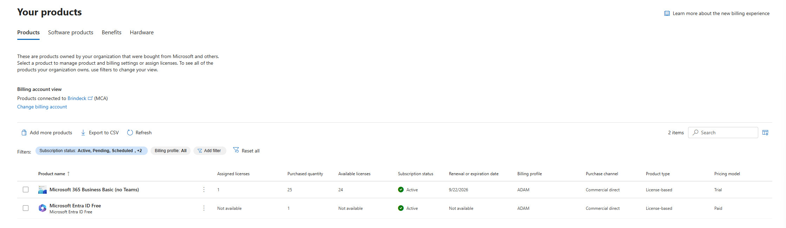
</p>

<p align="center">
  <em>Microsoft 365 admin center, Billing, Your products: Microsoft 365 Business Basic (no Teams) at 1 of 25 licenses assigned and 24 available, expiring 9/22/2026, and Microsoft Entra ID Free carried as a separate paid line with no assignable license count.</em>
</p>

The Billing, Your products page showed two active subscriptions rather than one. Microsoft 365 Business Basic (no Teams) carried 1 assigned license against a purchased quantity of 25, 24 available, with a stated renewal or expiration date of 9/22/2026, matching the lapse date the track README already carried; the 25-license purchase quantity had not previously been recorded. Microsoft Entra ID Free appeared alongside it as its own line, billed at 1 unit with assigned and available licenses both reported "Not available," which is the portal's way of showing a tenant's free-tier plan rather than an assignable product. Recurring billing is not a column on this view; Step Three confirmed it on the subscription's own page.

<p align="center">
  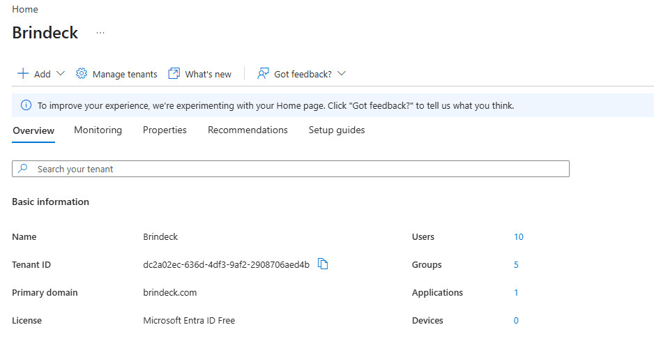
</p>

<p align="center">
  <em>Entra admin center Overview for Brindeck: Microsoft Entra plan Entra Free, 10 users, 5 groups, 1 application, and 0 devices.</em>
</p>

The Entra admin center Overview matched the expected baseline exactly.

<p align="center">
  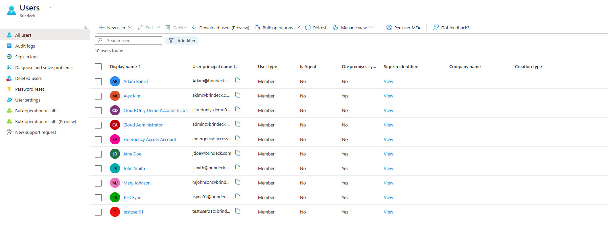
</p>

<p align="center">
  <em>All 10 users in the Entra admin center, with the On-premises sync column (the current portal's label for the field the track README calls Source) visible for each.</em>
</p>

The Users blade broke those 10 down by source: six synchronized from Windows Server AD (Alex Kim, Jane Doe, John Smith, Mary Johnson, Test Sync, and testuser01) and four cloud-only (Adam Ramzi, the signup account retained as Global Administrator since Lab 01; Cloud Administrator, `admin@brindeck.com`; the Emergency Access Account; and the Cloud-Only Demo Account, Lab 02's `cloudonly-demo01@brindeck.com` fixture).

<p align="center">
  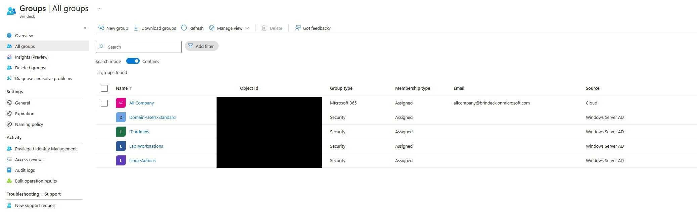
</p>

<p align="center">
  <em>All 5 groups in the Entra admin center, with type, membership type, and Source columns visible for each.</em>
</p>

The Groups blade confirmed the matching 4-and-1 split: `Domain-Users-Standard`, `IT-Admins`, `Lab-Workstations`, and `Linux-Admins` sourced from Windows Server AD, and `All Company` sourced from Cloud, a Microsoft 365 group with assigned membership and the address `allcompany@brindeck.onmicrosoft.com`.

<p align="center">
  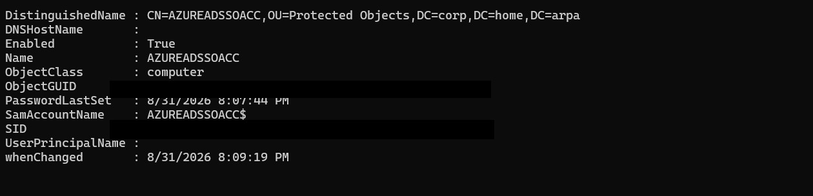
</p>

<p align="center">
  <em>`Get-ADComputer -Identity AZUREADSSOACC -Properties PasswordLastSet,whenChanged` against `corp.home.arpa`: PasswordLastSet 8/31/2026 8:07:44 PM, in `OU=Protected Objects`.</em>
</p>

`Get-ADComputer -Identity AZUREADSSOACC -Properties PasswordLastSet,whenChanged` returned a `PasswordLastSet` of 2026-08-31 8:07:44 PM, five days before this baseline was taken on 2026-09-05, comfortably inside the thirty-day window Microsoft recommends for rolling the seamless single sign-on Kerberos decryption key. Step Twelve owns whether to roll it.

### Step Two: Started the Microsoft 365 Business Premium trial

From the Microsoft 365 admin center, Billing, Add more products, a Microsoft 365 Business Premium trial was started in the existing tenant. The tenant accepted it without objection: a tenant that has already consumed a Microsoft 365 Business Basic trial is not blocked from starting a Microsoft 365 Business Premium trial in the same organization.

<p align="center">
  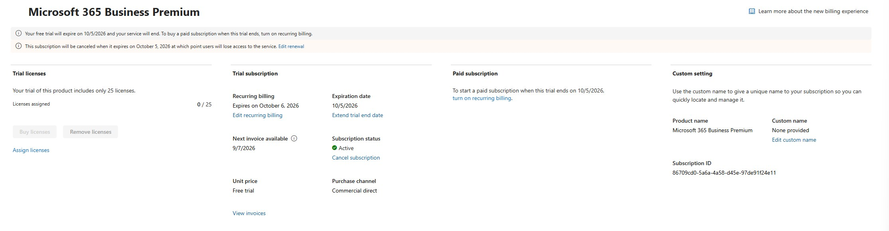
</p>

<p align="center">
  <em>Microsoft 365 admin center, the new Business Premium trial's subscription page: 25 trial licenses with 0 assigned, subscription status Active, unit price Free trial, purchase channel Commercial direct.</em>
</p>

The trial included 25 licenses, 0 of 25 assigned, matching Microsoft's own trial documentation.

The Plans and pricing view lists Business Premium as four separate rows, split with or without Teams and with or without Copilot. Only one carries a You own this tag, the plain "Microsoft 365 Business Premium (Trial)" row, not "Microsoft 365 Business Premium (no Teams) (Trial)." That places this trial on the with-Teams line, at $22.00 per user per month on annual commitment rather than the $18.79 no-Teams price.

The end date is not a single reading. The subscription page's Expiration date field reads October 5, 2026, and the Your products listing's Renewal or expiration date column agrees at 10/5/2026, but the same subscription page's Recurring billing field reads "Expires on October 6, 2026." The portal disagrees with itself about which of two adjacent dates is correct, and all three readings are recorded here.

### Step Three: Disabled recurring billing, and reconfirmed the Business Basic trial's state

Recurring billing on the new Business Premium trial was turned off in the same sitting as Step Two, using the Edit renewal control on the subscription's own page, before anything else was done with the trial. The subscription page shown above reflects the result: "Your free trial will expire on 10/5/2026 and your service will end. To buy a paid subscription when this trial ends, turn on recurring billing," and "This subscription will be canceled when it expires on October 5, 2026 at which point users will lose access to the service." That matches Microsoft's documented behavior for a trial with recurring billing off.

<p align="center">
  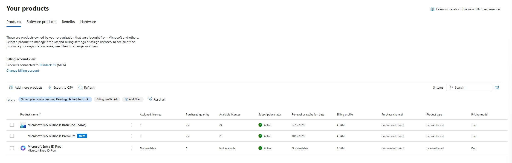
</p>

<p align="center">
  <em>Billing, Your products after Steps Two and Three: Business Basic (no Teams) at 1 of 25 assigned, 24 available, expiring 9/22/2026; Business Premium (new) at 0 of 25 assigned, expiring 10/5/2026 with recurring billing off; Microsoft Entra ID Free unchanged alongside both.</em>
</p>

The Business Basic trial's state was reconfirmed on the same page: Active, 1 of 25 licenses assigned and 24 available, with a renewal or expiration date of 9/22/2026 rather than a converted paid price, consistent with recurring billing having already been disabled on it.

The Basic trial's one assigned seat sits on the signup account, which Step Five leaves as it is, so the account holds no Business Premium license and loses its only license when the Basic trial lapses on 2026-09-22. Global Administrator does not require a license, so its directory and portal access are unaffected; what the lapse affects is the Exchange Online service the Basic seat provisioned. 2026-09-22 falls around day seventeen of the Business Premium trial's thirty-day window, close to when Microsoft's trial-expiry notices for that trial begin; where this tenant's billing notification mail actually landed was not established in this lab.

### Step Four: Verified what the trial actually granted

<p align="center">
  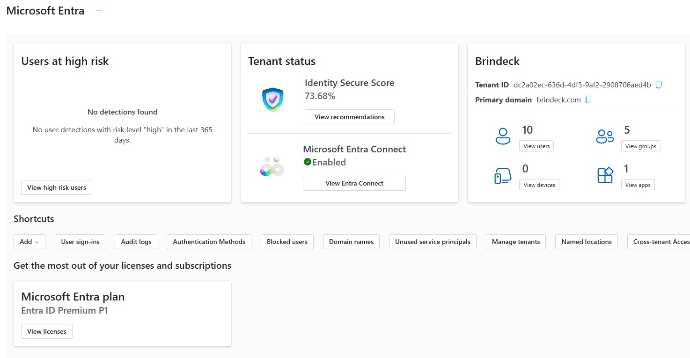
</p>

<p align="center">
  <em>Entra admin center Overview for Brindeck after Steps Two and Three: Microsoft Entra plan now reads Entra ID Premium P1, still 10 users, 5 groups, 0 devices, 1 application.</em>
</p>

The Entra admin center Overview confirmed the tenant's Microsoft Entra plan as Entra ID Premium P1, with License usage recording Entra ID (Entra ID P1) at 25, matching the 25 trial licenses Step Two recorded. Under Licensed features, Advanced Group Access Management, which dynamic membership groups and role-assignable groups both depend on, now reads Yes, while the Microsoft Entra ID P2 features beside it, Identity Protection, Privileged Identity Management, Access Reviews, and Entitlement management, still read as unavailable and tagged "Available in Microsoft Entra ID P2." The trial granted P1, not P2.

The scope guard held. Conditional Access > Policies showed the empty getting-started view the portal shows when a tenant has no policy. Security defaults' own settings panel read "Enabled," with "Your organization is currently using security defaults."

Exchange Online Plan 1 and Microsoft Intune Plan 1 were not visible in either admin center before assignment (see Troubleshooting and Adjustments), so the SKU was read with the Microsoft Graph PowerShell SDK from WIN11-CLIENT01:

```powershell
Connect-MgGraph -Scopes "Organization.Read.All"
$skus = Get-MgSubscribedSku
$skus | Select-Object SkuPartNumber, ConsumedUnits, @{N='Enabled';E={$_.PrepaidUnits.Enabled}}
```

returned `SPB` as the Business Premium trial's SKU part number, at 25 enabled seats and 0 consumed, alongside `Microsoft_365_Business_Basic_(no Teams)` at 25 enabled and 1 consumed. Reading that SKU's own service plan list,

```powershell
($skus | Where-Object SkuPartNumber -eq "SPB").ServicePlans | Sort-Object ServicePlanName | Format-Table ServicePlanName, ProvisioningStatus -AutoSize
```

returned 62 service plans, all `Success` except `INTUNE_O365` at `PendingActivation`. Cross-referenced against Microsoft's product names and service plan identifiers reference, `AAD_PREMIUM` is Microsoft Entra ID P1, `EXCHANGE_S_STANDARD` is Exchange Online (Plan 1), and `INTUNE_A` is Microsoft Intune Plan 1, all three `Success`. The SKU also carries `INTUNE_SMBIZ` (Microsoft Intune, a second and distinct Intune plan bundled alongside Plan 1) and `INTUNE_O365` (Mobile Device Management for Office 365, a narrower predecessor capability), neither of which the plan asked for.

### Step Five: Assigned licenses per user, and established usage location

Business Premium was assigned to five accounts: two cloud-only, `admin@brindeck.com` and `cloudonly-demo01`, and three synchronized, `testuser01`, Alex Kim, and Jane Doe, to put both object types on both sides of every licensing observation this lab makes. The Emergency Access Account and the signup account were left untouched.

License assignment in the current Microsoft 365 admin center lives on a Licenses and apps tab that combines usage location and license selection in one panel, rather than the separate Account-tab location field this lab's plan expected. The panel never showed a blank Select location field on testuser01. Before anything on the account had been touched, the dropdown already read United States, resolved from the tenant's default rather than from anything set on the object, so there was no unset state to provoke a validation error against. An administrator working this screen sees a settled location for every account whether or not anyone ever set one deliberately. Checking Microsoft 365 Business Premium and saving with that pre-filled value untouched succeeded without further prompt.

<p align="center">
  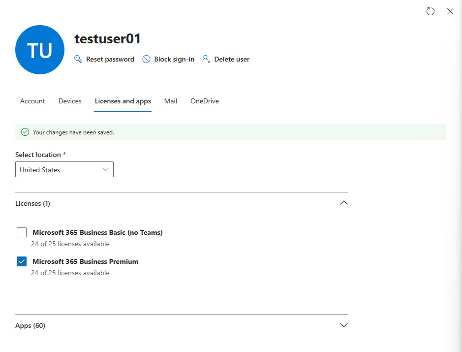
</p>

<p align="center">
  <em>testuser01's Licenses and apps tab after saving: Select location still reads United States, "Your changes have been saved," Licenses (1) with Business Premium checked and 24 of 25 licenses available, Apps (60) collapsed below.</em>
</p>

The panel confirmed "Your changes have been saved," the tenant's available count moved from 25 of 25 to 24 of 25, and the tab's Apps section reported 60 apps under the newly assigned SKU, against the 62 service plans Step Four read from the same SKU through Microsoft Graph. The two-item gap was not chased. `INTUNE_O365`'s `PendingActivation` plausibly accounts for one of the two, and `AAD_PREMIUM` being a licensing feature rather than a user-facing app plausibly accounts for the other, though neither is confirmed here.

The remaining four accounts, `admin@brindeck.com`, `cloudonly-demo01`, Alex Kim, and Jane Doe, were licensed together from the Active users list's Manage product licenses bulk action instead of one at a time. That path never presented a usage location control at all, going directly from account selection to license assignment.

<p align="center">
  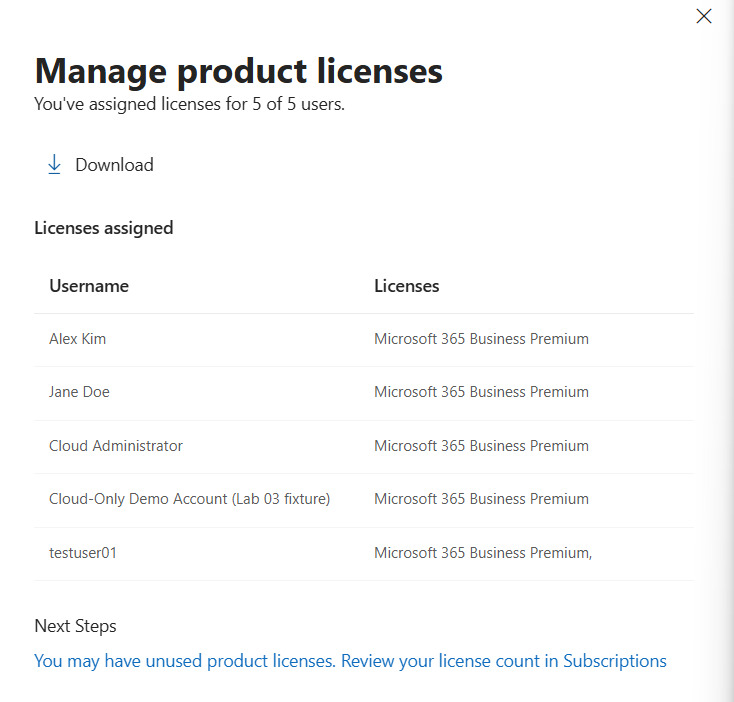
</p>

<p align="center">
  <em>The Manage product licenses confirmation: "You've assigned licenses for 5 of 5 users," listing Alex Kim, Jane Doe, Cloud Administrator, Cloud-Only Demo Account (Lab 03 fixture), and testuser01, each against Microsoft 365 Business Premium.</em>
</p>

The confirmation dialog listed all five accounts, the four just licensed together plus testuser01 from the first pass. A spot check of all five accounts' own Licenses and apps tabs afterward showed United States on every one, so the bulk path resolved the same tenant default without surfacing the control. No difference appeared between the two cloud-only accounts and the three synchronized ones at any point in this step: licensing behaved as a cloud-side property of the object rather than as something the synchronization boundary touches. testuser01's row in the dialog read "Microsoft 365 Business Premium," with a trailing comma and nothing following it, a rendering artifact of the summary view, since testuser01's own tab showed only the one SKU under Licenses (1).

Security defaults' effect on these five accounts at first cloud sign-in was not re-tested here. Lab 02 Step Seven established that the setting is tenant-wide, and it applies to each of these five the first time any of them signs in to a cloud service.

### Step Six: Catalogued the tenant's groups, and built a dynamic membership group

Inventoried every group in the tenant by type, membership type, and source; created the environment's first two cloud-only groups; and built its first dynamic membership group, keyed to an attribute populated on-premises for the purpose.

`All Company` predates all synchronization, as Lab 02's baseline recorded. It is a Microsoft 365 group with Assigned membership, sourced from Cloud. Its description reads "This is the default group for everyone in the network," but nothing about the object enforces that: membership is static and administrator-maintained like any other assigned group, and none of the six synchronized users are members. Its one direct member is Adam Ramzi, the cloud-only Global Administrator from Lab 01. Whether its creation was tenant provisioning or a manual action could not be settled from Audit logs: retention in this tenant reaches back only to 2026-08-31, eight days short of the group's 2026-08-23 creation, so the creation event had already rolled off.

<p align="center">
  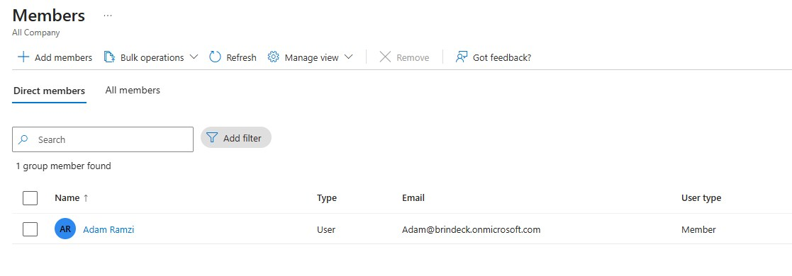
</p>

<p align="center">
  <em>All Company's Members page: 1 group member found, Adam Ramzi, its only current member, in a group whose description reads "the default group for everyone in the network."</em>
</p>

Two cloud-only groups were created to compare against that baseline: `Finance`, an assigned security group, and `Company Announcements`, an assigned Microsoft 365 group. Creating the Microsoft 365 group surfaced a field the security group flow never asked for, a group email address auto-derived from the name (`CompanyAnnouncements@brindeck.com`).

A group arriving from `OU=Groups` can only be managed on-premises, and on more than membership alone. `IT-Admins`' Properties page showed Group name, Group description, and Membership type all greyed out under a "Some groups can't be managed in the Azure portal" banner, while the same three fields on `Finance`'s Properties page were live and editable. `IT-Admins`' Members page repeats the banner. It showed exactly the count Lab 02 flagged: three members in the tenant (Alex Kim, John Smith, Mary Johnson) against four on-premises, since `labadmin` sits in the excluded `OU=IT`, with nothing in the portal indicating the list is partial.

<p align="center">
  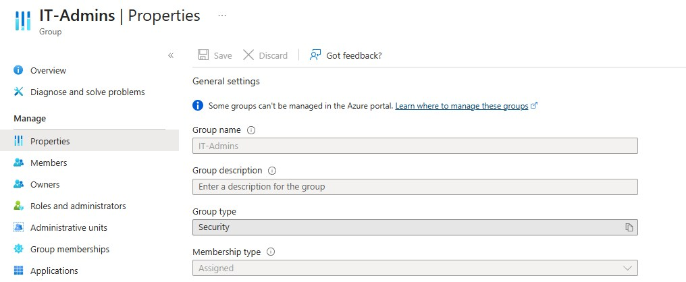
</p>

<p align="center">
  <em>IT-Admins' Properties page: Group name, Group description, and Membership type all greyed out with placeholder text only, under the "Some groups can't be managed in the Azure portal" banner. Finance's equivalent page, by contrast, showed all three fields live and editable.</em>
</p>

**Six-A: populated `department` and confirmed it could carry a rule.** `department` was set on all six synchronized accounts from WIN11-CLIENT01 with `Set-ADUser`, starting from confirmed-blank across the board: `akim`, `jdoe`, `testuser01`, and `tsync01` to `IT`; `jsmith` and `mjohnson` to `Sales`.

Microsoft's synchronized-attributes reference lists `department` under the Exchange Online, SharePoint Online, and Teams attribute groups, so Entra Connect carries it without a custom rule. With `Get-ADSyncScheduler` reading `SyncCycleEnabled: True`, a `Start-ADSyncSyncCycle -PolicyType Delta` was run, and `Get-MgUser` read the values back from the tenant matching the on-premises values exactly. In the dynamic membership rule builder's Property picker, `department` appears as a selectable item, so the rule did not need the raw rule-syntax text box, and `title` was not needed as a fallback.

<p align="center">
  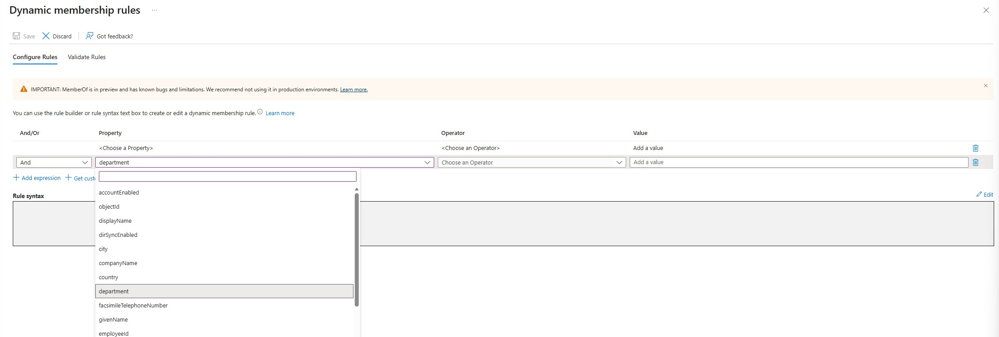
</p>

<p align="center">
  <em>The dynamic membership rule builder's Property picker, department typed and highlighted in the searchable list, sitting alphabetically between country and facsimileTelephoneNumber.</em>
</p>

**Six-B: built the rule, watched it evaluate, and timed the round trip.** `IT-Department`, a Security group with Dynamic User membership, was created with the rule `(user.department -eq "IT")`. Its Members page initially showed zero. The built-in Validate Rules tool, which evaluates the rule live against named users rather than waiting on background processing, confirmed the logic immediately: Alex Kim, Jane Doe, and testuser01 validated `In group`; John Smith and Mary Johnson validated `Not in group`. `tsync01`, also set to `IT`, was not one of the named users run through the tool. The group was created at 3:34 PM and its membership materialized by 3:36 PM, roughly two minutes for the initial evaluation.

<p align="center">
  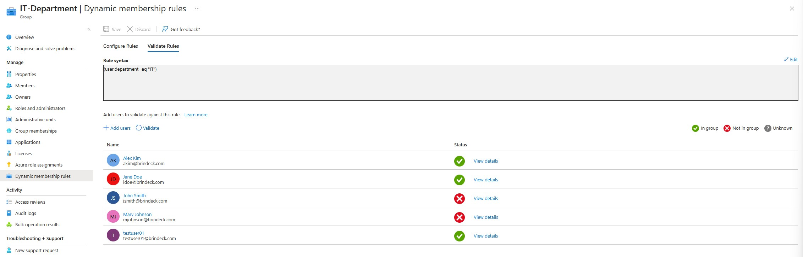
</p>

<p align="center">
  <em>Validate Rules against five of the tenant's six synchronized users: Alex Kim, Jane Doe, and testuser01 shown In group; John Smith and Mary Johnson shown Not in group, confirming the rule's logic before the group's own membership had finished materializing. tsync01, also set to department IT, was not included in this check.</em>
</p>

`Set-ADUser -Identity jsmith -Department "IT"` landed on-premises at 3:40:25 PM, confirmed with `Get-Date` immediately before and after, and a Delta cycle was forced right afterward.

<p align="center">
  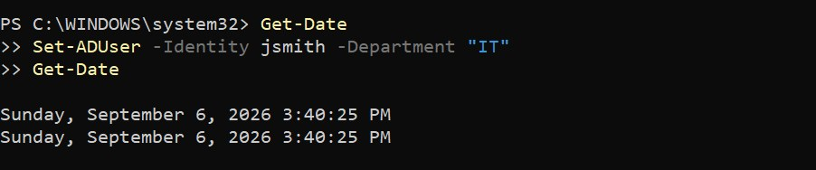
</p>

<p align="center">
  <em>Get-Date, Set-ADUser -Identity jsmith -Department "IT", and Get-Date again: both timestamps read Sunday, September 6, 2026 3:40:25 PM.</em>
</p>

`IT-Department`'s Overview page showed the fifth member, John Smith, with a "Last membership change" of 3:45 PM. At the portal's minute-level precision, the interval from the on-premises write to the cloud group gaining a member nobody touched directly is a range: between 4 minutes 35 seconds and 5 minutes 34 seconds.

<p align="center">
  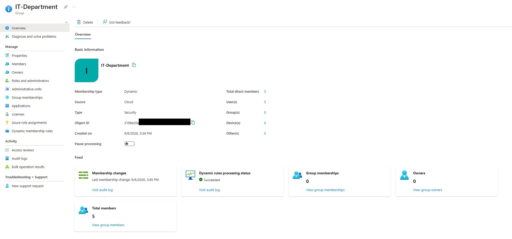
</p>

<p align="center">
  <em>IT-Department's Overview after the round trip: Total direct members 5, Dynamic rules processing status Succeeded, Last membership change 9/6/2026, 3:45 PM.</em>
</p>

Microsoft's reference documents constraints not exercised here: membership cannot be edited by hand; a rule cannot mix users and devices in the same group; a device membership rule can reference only device attributes, never the device owner's; and the Microsoft Entra ID P1 requirement is counted per unique user across all of a tenant's dynamic groups, so a member needs no license assigned, but the tenant needs at least as many P1 licenses as it has unique dynamic-group members.

The security consideration from Design Decisions was checked, and the finding runs opposite to what Microsoft's general warning would suggest on its own. `dsacls` against a synchronized user object showed `NT AUTHORITY\SELF` granted `WRITE PROPERTY` on exactly four property sets: Personal Information, Phone and Mail Options (empty on this schema version), Web Information, and the inherited Private Information. `department` belongs to none of them; it is a member of the Public-Information property set, and the only ACE naming Public Information in the object's ACL grants `READ PROPERTY` to `Authenticated Users`, with no write grant on it at all. On this default Windows Server 2022 schema, a synchronized user cannot set their own `department` value and add themselves to `IT-Department`. The risk Microsoft describes is real for Active Directory generally; it is not realized here, because nothing has delegated Public-Information write to SELF.

**Active Directory changes this step made:** `department` was set on all six synchronized users, with final values `akim`, `jdoe`, `testuser01`, and `tsync01` at `IT`; `mjohnson` at `Sales`; and `jsmith` at `IT`, changed from `Sales` mid-step for the round trip. No other on-premises object was touched.

### Step Seven: Assigned a built-in directory role to a user, and built the tenant's first role-assignable group

Assigned License Administrator to `testuser01` at tenant (Directory) scope and tested what it authorizes and blocks against a live account, then created the tenant's first role-assignable group and assigned Groups Administrator to it. Nothing in this step touched Active Directory.

**Seven-A: assigned License Administrator to testuser01, and read its boundary against a live account rather than only against Microsoft's documented permissions.**

License Administrator was assigned to `testuser01` at Directory scope, Assignment type Active rather than Eligible. Privileged Identity Management, which would allow Eligible assignments and just-in-time activation, requires Microsoft Entra ID P2; this tenant holds P1 only and this track does not plan to acquire P2, so both of this step's assignments are standing rather than time-bound. The Assignments tab confirmed `testuser01` / `testuser01@brindeck.com`, Type User, Scope Directory. Signing in as `testuser01` met the same forced Authenticator registration Lab 02 Step Seven documented; holding License Administrator did not change it.

Alex Kim's Licenses blade in the Entra admin center, opened as `testuser01`, showed her assignment (Microsoft 365 Business Premium, Active, 53 of 53 enabled services, Direct assignment path) under a banner reading "Adding, removing, and reprocessing licensing assignments is only available within the M365 Admin Center." That blade only reads, for any role. Its "53 of 53" is a third count against the same SKU, and none of the three agree: Step Four's Graph reading found 62 service plans and Step Five's Microsoft 365 admin center Apps section found 60. Whether "enabled services" is the same unit as "apps" or "service plans" is not established here.

In the Microsoft 365 admin center, the same account's Licenses and apps tab was live. `testuser01`, holding nothing but License Administrator, unchecked Alex Kim's Business Premium license and saved; the panel confirmed "Your changes have been saved," and the tenant's Business Premium count moved to 21 of 25 available, one more than the 20 Step Five's five assignments had left.

<p align="center">
  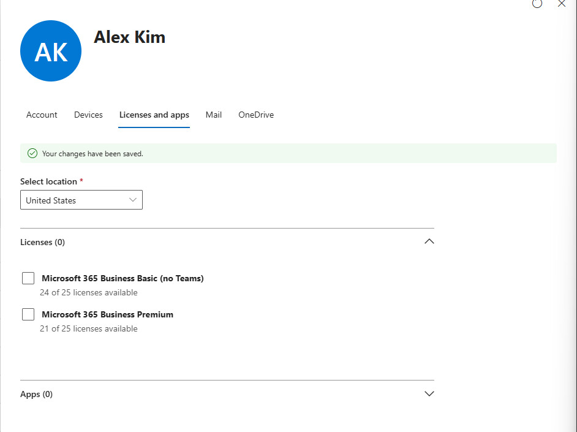
</p>

<p align="center">
  <em>Alex Kim's Licenses and apps tab in the Microsoft 365 admin center, as testuser01: "Your changes have been saved," Licenses (0), Business Premium showing 21 of 25 licenses available after the removal.</em>
</p>

Alex Kim's license was restored immediately afterward, so Steps Eight through Twelve proceed from the state Step Five established.

The negative side split into two results, only one of which was about the role. Identity > Users > New user was greyed out for `testuser01`: License Administrator carries no user-creation permission. Identity > Groups > New group succeeded, but not because of the role. Identity > Groups > General showed Users can create security groups in Azure portals, API or PowerShell and Users can create Microsoft 365 groups in Azure portals, API or PowerShell both set to Yes at the tenant level, untouched since Lab 01, which authorizes group creation for any authenticated member regardless of role. License Administrator grants no group-management capability; the tenant simply never restricted who else has it. The group `testuser01` created was deleted immediately afterward.

<p align="center">
  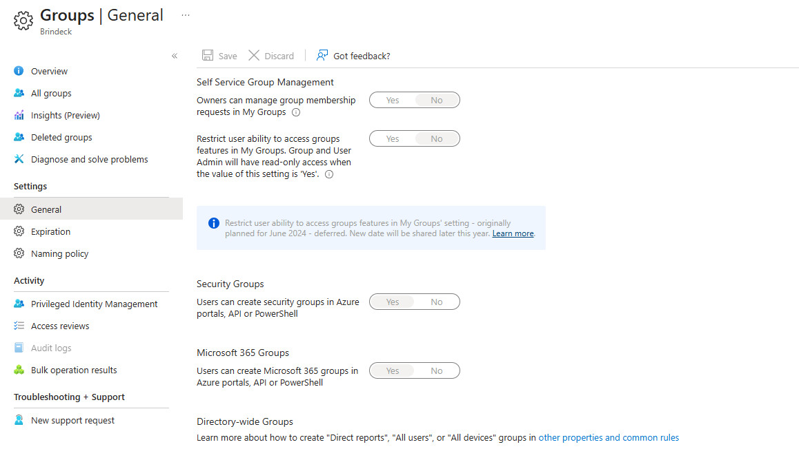
</p>

<p align="center">
  <em>Identity > Groups > General: Users can create security groups in Azure portals, API or PowerShell, and Users can create Microsoft 365 groups in Azure portals, API or PowerShell, both set to Yes, the tenant default this lab found unchanged.</em>
</p>

**Seven-B: built the tenant's first role-assignable group, and confirmed the eligibility rule is set at creation, not toggled on afterward.**

From the Global Administrator account, Groups Administrator's Add assignments panel, filtered to its Groups tab, returned "No results found," with the tenant holding eight groups: four synchronized from `OU=Groups`, plus `All Company`, `Finance` and `Company Announcements` from Step Six, and `IT-Department`. `IT-Department` is excluded on a second, independent ground as well, since Microsoft's role-assignable group documentation requires Assigned membership and `IT-Department` is Dynamic. None of the eight qualified, cloud-only, dynamic, or neither, because none was created with role-assignability enabled, and the product does not offer a way to turn it on afterward.

`Groups-Administrators` was created as the alternative: Security type, Assigned membership, one member (Jane Doe), and the Microsoft Entra roles can be assigned to the group toggle enabled at creation, live now that the tenant holds Microsoft Entra ID P1. No role was assigned from the creation panel itself. Reopened afterward, Groups Administrator's Add assignments panel, filtered to Groups, returned `Groups-Administrators` as a selectable result. Adding it produced "Successfully added assignment Groups-Administrators," and the role's Assignments tab listed it: Type Group, Scope Directory.

<p align="center">
  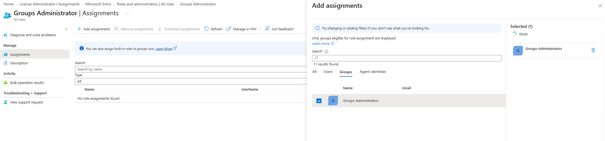
</p>

<p align="center">
  <em>The same Add assignments panel, Groups tab, after Groups-Administrators was created with role-assignability enabled: it appears and is selectable, where no existing group had.</em>
</p>

<p align="center">
  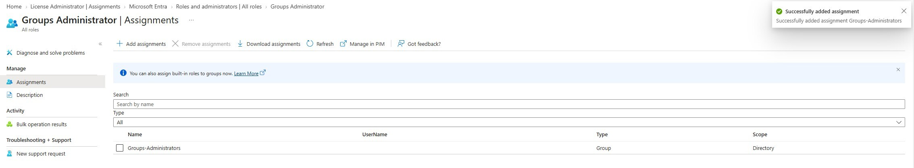
</p>

<p align="center">
  <em>"Successfully added assignment Groups-Administrators," and Groups Administrator's Assignments tab listing Groups-Administrators, Type Group, Scope Directory.</em>
</p>

`Groups-Administrators`' own Assigned roles blade listed Groups Administrator with Resource name Directory, Resource type Organization, Assignment path Direct, Role type Built-in. Its Properties page showed Membership type greyed out: the product enforces the Assigned-membership constraint by locking the field once the group holds the role-assignable flag, rather than by accepting a change and failing it afterward.

### Step Eight: Assigned licenses by group, and found where a direct assignment and a group assignment collide

Assigned Business Premium to two of Step Six's cloud-only groups, watched licenses get granted and revoked by membership alone, moved a user between the two in Microsoft's documented order, and tried and failed to produce a license assignment error by three separate routes.

**Eight-A: assigned Business Premium to Finance, and checked the tenant's own screens against the documentation claim.**

The Business Premium product page in the Microsoft 365 admin center mentioned no licensing prerequisite on the group-assignment path. Its only banner read "Licensing operations may take longer for tenants with many users," and it carries no separate Groups tab: groups and members share one combined list under the text "To manage your licenses, select a group or member." The Assign licenses panel's own copy corroborated one of the constraints Microsoft's documentation states: "Assign licenses for Microsoft 365 Business Premium to members or groups in your organization, a maximum of 20 at a time."

`Finance` was selected as the target. It held zero members, so the assignment consumed no seats, and it appeared on the product page as its own row with a Type of Group. `IT-Department` was not used, since a dynamic group's membership cannot be edited by hand.

**Eight-B: added a clean subject to Finance, and watched a license apply through membership alone.**

`John Smith`, who held no license of any kind at this point, was added to `Finance`. Business Premium was already checked on his Licenses and apps tab by the time it was opened. The tab gave no indication of where the license came from, no badge or note distinguishing a group-sourced grant from a direct one, where the Entra admin center's Licenses blade in Step Seven labeled Alex Kim's assignment "Direct assignment path." The same fact is visible on one admin surface and invisible on the other.

**Eight-C: tested what happens when a direct assignment and a group assignment supply the same license to the same user.**

`testuser01` already held Business Premium directly, assigned in Step Five, and was added to `Finance` as well. On his own Licenses and apps tab, Business Premium was unchecked and saved. The save was immediate and total: Licenses (0), and the tenant-wide count dropped to 5 of 25 assigned.

<p align="center">
  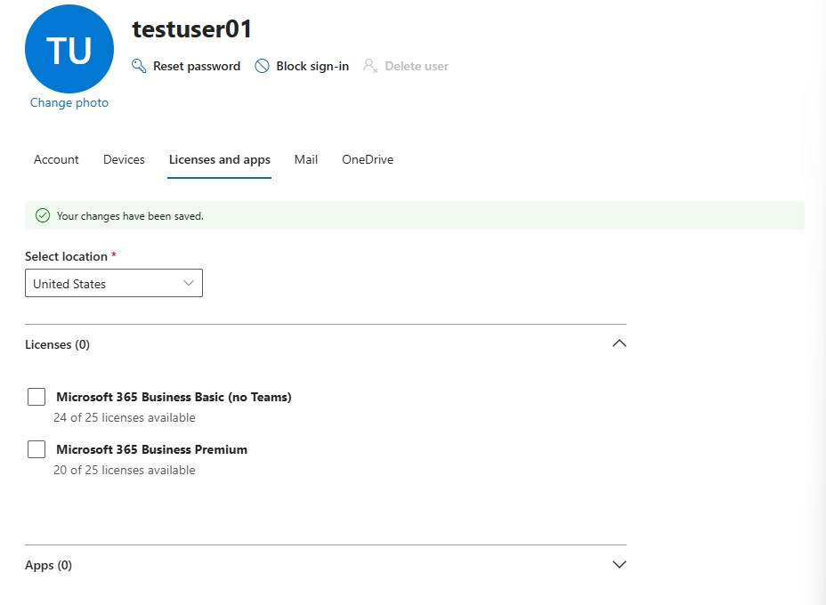
</p>

<p align="center">
  <em>testuser01's Licenses and apps tab immediately after unchecking Business Premium and saving: Licenses (0), Business Basic 24 of 25 and Business Premium 20 of 25 available.</em>
</p>

Checking the Business Premium product page's Errors & Issues tab shortly afterward told a different story: 6 of 25 assigned, zero licensing errors, zero members without licenses.

<p align="center">
  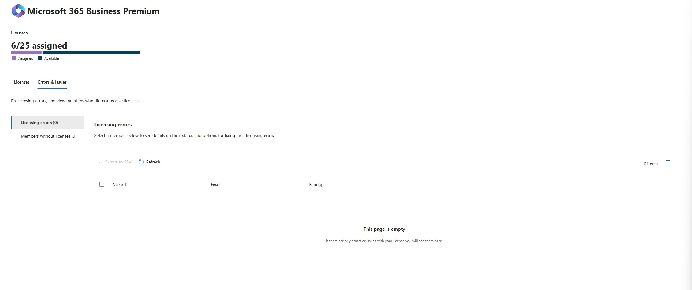
</p>

<p align="center">
  <em>The Business Premium product page's Errors & Issues tab, checked moments after the previous screenshot: 6 of 25 assigned again, no errors, no members without licenses.</em>
</p>

Group-based licensing had silently reasserted the license while `testuser01` remained a `Finance` member, and his own tab showed Business Premium checked again. The gap between unassignment and reassertion was real, on the order of the time it took to navigate from one screen to the other, and not visible anywhere as a warning while it was happening.

Removing `testuser01` from `Finance` immediately afterward showed whether the direct assignment had survived underneath the group's reassertion. It had not: his license disappeared entirely the moment group membership ended. Unchecking a direct assignment on a user who is also group-licensed does not stick while the membership continues, but it does permanently remove the direct component, and the user is left licensed entirely by the group whether or not an administrator realizes it. Business Premium was then reassigned to `testuser01` directly, restoring the state Step Five established.

**Eight-D: moved a user between two licensed groups in Microsoft's documented order.**

Business Premium was assigned to `Company Announcements` as well, Step Six's other assigned-membership cloud-only group. `John Smith`, still licensed purely through `Finance` membership at this point, was added to `Company Announcements` first, and his license was confirmed still applied. Only then was he removed from `Finance`.

<p align="center">
  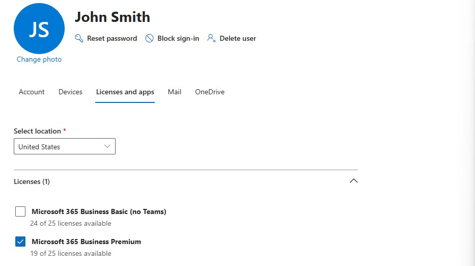
</p>

<p align="center">
  <em>John Smith's Licenses and apps tab after being removed from Finance, having already been added to Company Announcements: Business Premium stayed checked throughout, no gap.</em>
</p>

The license stayed checked the entire time. Adding to the destination, confirming, then removing from the source produced zero interruption, while removing support before a replacement applied, as Eight-C did by accident, produced a real if temporary one.

**Eight-E: attempted to induce a license assignment error, and could not, by three separate routes.**

No existing account had an unset usage location; Step Five showed every account resolving to United States as soon as a licensing screen touched it. To test group-based licensing specifically, `nolocation-demo01` was created as a cloud-only fixture using the "Create user without product license" option, and added directly to `Finance` without its own Licenses and apps tab ever being opened.

It was licensed successfully, United States resolved, zero entries on Errors & Issues. Microsoft 365 Business Basic (no Teams) was then also assigned to `Finance`, giving `nolocation-demo01` both SKUs at once to test whether the tenant would treat them as conflicting. Both applied cleanly, no error of any kind.

<p align="center">
  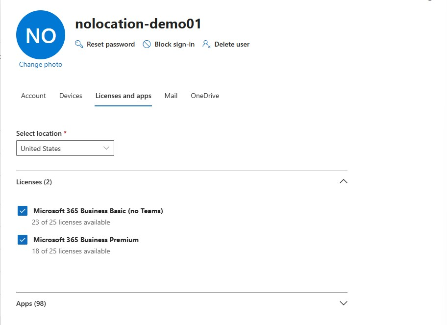
</p>

<p align="center">
  <em>nolocation-demo01's Licenses and apps tab: both Business Basic and Business Premium checked, Select location resolved to United States despite never being set deliberately, Apps (98).</em>
</p>

Insufficient licenses was not attempted; a 25-seat trial against a ten-user tenant could not reach it. None of the three most reachable license-assignment failure modes, an unlocated user, two overlapping SKUs, or exhausted seats, produced an error through the Microsoft 365 admin center on this tenant. A real error here would need either a much larger population or two genuinely mutually-exclusive SKUs, and this environment has neither.

`nolocation-demo01` was deleted once the test concluded, and the deletion itself surfaced one more finding on the way out. The account was deleted successfully, but the portal also reported a partial failure: "We couldn't unassign licenses for this user. One or more of the licenses could not be modified because they are inherited from a group membership. Manage group-based licenses from the Licenses and apps pivot in the Group Details page."

<p align="center">
  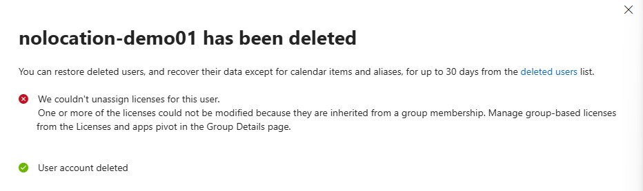
</p>

<p align="center">
  <em>The delete confirmation for nolocation-demo01: "User account deleted" alongside a failure to unassign its group-inherited licenses first, which did not block the deletion.</em>
</p>

A user's group-inherited licenses are not unassignable through the same flow that unassigns direct ones.

**Constraints recorded from documentation.** Group-based licensing does not process nested groups: only first-level members of a licensed group receive licenses. None of the synchronized groups is currently nested, and nesting was not tested. Licenses can be assigned to a maximum of twenty groups or members at a time, as the Assign licenses panel's own copy stated in Eight-A.

**The P1 prerequisite question, settled as far as this lab can settle it.** Microsoft's current group-based licensing documentation states no license tier prerequisite of its own, and nothing on this tenant's assignment screens claimed one. This tenant holds Microsoft Entra ID P1 throughout Lab 03, so whether Entra ID Free would permit or block group-based licensing is not something this lab can observe.

**Final state.** Read from the Business Premium and Business Basic product pages: Business Premium stood at 6 of 25 assigned. Five were direct assignments, held by Alex Kim, the Cloud Administrator, `cloudonly-demo01`, Jane Doe, and `testuser01`. The sixth was `John Smith`'s, sourced entirely through `Company Announcements` membership from Eight-D onward. `Finance` held no members after `testuser01`'s removal in Eight-C and `nolocation-demo01`'s deletion in Eight-E, so it consumed no seats, but it carries two group-level assignments: Business Premium from Eight-A and Business Basic from Eight-E. Business Basic's consumed count held at 1 of 25, which hides that any future member added to `Finance` would draw both SKUs at once. That Business Basic assignment sits on the trial that lapses on 2026-09-22. No on-premises object was touched.

**Correction, added when Step Ten reopened this state (2026-09-08).** `John Smith`'s sourcing through `Company Announcements` held only until 4:03:32 PM on 9/7/2026; see Troubleshooting and Adjustments. The "6 of 25" figure above was read from a page whose counting basis was not understood at the time. At this step's close the Business Premium composition was five licensed users, two licensed groups, and `John Smith` in `Company Announcements`: seven assignment targets and six consumed seats, the identical composition the tenant holds now. The page read 6 of 25 then and reads 7 of 25 now. Step Ten's Part C establishes that the page currently counts assignment targets, and the two readings cannot be reconciled from outside the product. The six consumed seats stand, a figure Part C confirms independently.

`nolocation-demo01` is not fully gone: deletion moves a user into Deleted users for up to 30 days, per Microsoft's documented retention behavior, and this step did not check the Deleted users list. Combined with the unassignment failure above, that left open a soft-deleted object still holding a group-inherited license, which Nine-A settled.

### Step Nine: Deleted and restored users, on both object types

Deleted and restored a cloud-only user and a synchronized user, and documented how the two differ. The on-premises half was not reversible in this forest: `corp.home.arpa` has no Active Directory Recycle Bin, Lab 02 having deferred that recommendation to the Enterprise Infrastructure track rather than enabling a forest-wide, irreversible setting mid-lab.

**Nine-A: settled Step Eight's open question before touching either named subject.**

Step Eight left `nolocation-demo01` in Deleted users with a partial-failure warning. Before deleting `cloudonly-demo01` or creating `deltest01`, this step checked whether its group-sourced licenses survived the soft delete. The portal showed the object in Deleted users, deleted Sep 7, 2026, 4:01 PM.

<p align="center">
  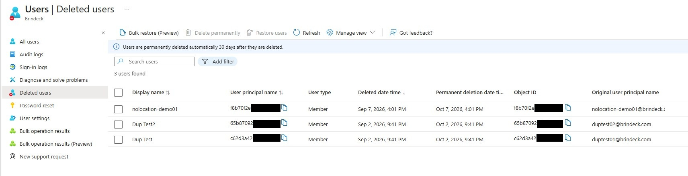
</p>

<p align="center">
  <em>Deleted users at the start of Step Nine: nolocation-demo01 alongside Dup Test and Dup Test2, Lab 02's duptest01 and duptest02.</em>
</p>

A raw `Invoke-MgGraphRequest -Method GET` against `/directory/deletedItems/microsoft.graph.user` with an explicit `$select` read the deleted objects' `assignedLicenses`, after two false starts recorded in Troubleshooting and Adjustments. It showed `assignedLicenses` empty for both `duptest01` and `duptest02`, and two entries for `nolocation-demo01`, matching the two SKUs `Finance` had carried: `21502a13-c8dc-4744-be9c-177fd9d2eafc` (Business Basic, no Teams) and `cbdc14ab-d96c-4c30-b9f4-6ada7cdc1d46` (SkuPartNumber `SPB`, Business Premium), confirmed against `Get-MgSubscribedSku`. These are Microsoft SKU identifiers, not directory object IDs: identical in every tenant and publicly documented, so they are left in full.

A soft-deleted object retains its group-inherited licenses along with everything else Microsoft documents as preserved. Step Eight's unassign failure on the way out was not cosmetic: the licenses never left. `nolocation-demo01` was left as found.

The other two objects in Deleted users are `duptest01` and `duptest02`, the on-premises collision fixtures Lab 02 Step Nine deleted with `Remove-ADUser` after the Duplicate Attribute Resiliency test. Lab 02 recorded their cleanup as complete: "confirming their cleanup left no residue," and, in its Step Ten reconciliation, "`duptest01` and `duptest02` fully gone on both sides." Neither is true in the tenant. Both are soft-deleted, not purged, deleted Sep 2, 2026, 9:41 PM, with thirty-day windows that expire around Oct 2, 2026. Lab 02's reconciliation checked on-premises OU counts and the tenant's Overview user count, and neither can distinguish a soft-deleted object from a purged one: Deleted users does not count toward the Overview total, which read 10 users at this step's close while three more objects sat in Deleted users. Both were left for Step Twelve.

**Nine-B: the cloud-only case, fully reversible.**

Nine-C ran earlier the same day, Sep 8, 2026, so its timestamps are earlier than this sub-step's; the cases are presented by object type, the fully reversible one first.

`cloudonly-demo01` was set up to exercise license, group membership, and role assignment together: it was added to `All Company`, the tenant's unlicensed, cloud-only, assigned-membership Microsoft 365 group, and assigned the `License Administrator` directory role Step Seven validated against `testuser01`. `Finance` and `Company Announcements` were ruled out because each carries a group-based license assignment that would layer an Eight-C-style collision on top of this read, and `IT-Department` because its dynamic membership can't be edited by hand. The pre-delete baseline: object Id `0c305ee2-...`, one direct license (`cbdc14ab-d96c-4c30-b9f4-6ada7cdc1d46`, Business Premium), and a `memberOf` of exactly two entries, `All Company` (`#microsoft.graph.group`) and `License Administrator` (`#microsoft.graph.directoryRole`).

Deleted through the portal at 2:26 PM on Sep 8, 2026, with no partial-unassign warning, consistent with Nine-A: this account holds no group-inherited license. The object appeared in Deleted users immediately, permanent deletion date Oct 8, 2026, 2:26 PM.

Restored through the portal, all three properties came back identical to the baseline, the same license, the same group membership, and the same directory role assignment, confirmed by re-running the same two Graph queries against the restored object.

`cloudonly-demo01` was then returned to its pre-test state, license-only with no group and no role, confirmed by an empty `memberOf`. Labs 04 and 05 both inherit it.

**Nine-C: the synchronized case, reversible on the cloud side and terminal on-premises.**

`deltest01` was created for this step, via `New-LabUser.ps1` from WIN11-CLIENT01, left at its default target OU (`OU=User Accounts,DC=corp,DC=home,DC=arpa`), which is the synchronized OU and carries the routable `@brindeck.com` UPN suffix per ADR-019. It synchronized promptly and confirmed in the tenant with object Id `4dc7ca85-...`.

Deleted in the tenant only, through the portal, at 12:28 PM on Sep 8, 2026, leaving the on-premises object untouched. `Get-ADSyncScheduler` gave the next scheduled Delta cycle as 12:46:09 PM, and the step waited for that unattended run rather than forcing it. By 12:55 PM, `deltest01` resolved again through `Get-MgUser` with the identical object Id, `4dc7ca85-...`. Nothing was checked between the 12:46:09 PM cycle and the 12:55 PM confirmation, so the window is eighteen to twenty-seven minutes after the delete. Design Decisions' prediction held: Microsoft Entra is not the source of authority for a synchronized object, so an Entra-side delete against a still-existing on-premises source does not stick.

The on-premises half did not undo itself. `Remove-ADUser -Identity "deltest01"` ran from WIN11-CLIENT01 at 12:57 PM. With no Active Directory Recycle Bin on `corp.home.arpa`, there was no Deleted Objects container behind it: the object was simply gone. The next Delta cycle, scheduled 1:17:16 PM, carried the deletion to the cloud side: `Get-MgUser` stopped resolving the account, and the same object, `4dc7ca85-...`, reappeared in Deleted users, soft-deleted a second time at 1:20 PM, with nothing on-premises left to restore it from.

`deltest01` was then recreated on-premises with the identical `sAMAccountName` and UPN, at 1:30 PM. The next cycle, 1:47:44 PM, provisioned it in the tenant under a different object Id: `f99ab470-...`.

<p align="center">
  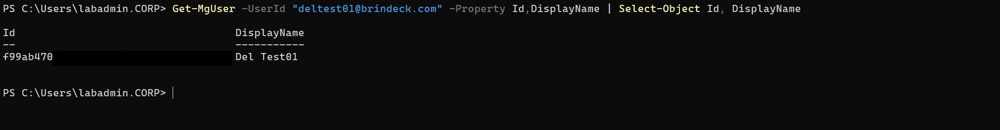
</p>

<p align="center">
  <em>deltest01 recreated on-premises with the same sAMAccountName and UPN: Get-MgUser resolves it to f99ab470-..., a different object than the one still orphaned in Deleted users.</em>
</p>

The recreated on-premises object carries a new `objectGUID` and therefore a new `ms-DS-ConsistencyGuid` source anchor, so Entra Connect provisioned an unrelated second cloud object rather than rejoining the one it had already soft-deleted. The original object, `4dc7ca85-...`, stayed orphaned in Deleted users with its thirty-day restore window still technically open and nothing on-premises left to claim it. The soft-delete safety net that holds for a cloud-only object does not hold for a synchronized object whose source has been destroyed, a concrete cost of the Active Directory Recycle Bin recommendation Lab 02 deferred, for the Enterprise Infrastructure track to weigh when it takes the decision up.

**Cleanup.** The recreated on-premises `deltest01` was deleted a second time, and the sync cycle was triggered manually rather than watched. Once the second cloud object, `f99ab470-...`, appeared in Deleted users alongside the orphaned `4dc7ca85-...`, both were permanently purged through the portal's bulk delete.

<p align="center">
  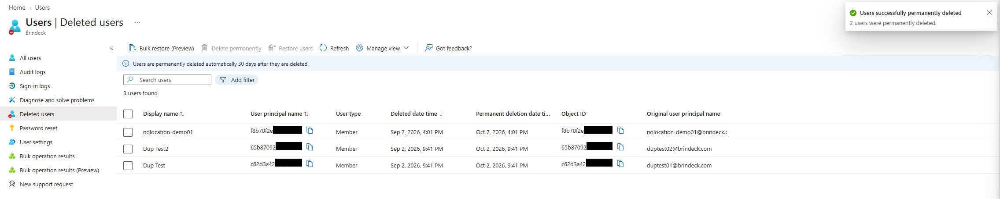
</p>

<p align="center">
  <em>Both deltest01 objects purged from Deleted users: "2 users were permanently deleted," the list back to the three unrelated objects, nolocation-demo01, Dup Test, and Dup Test2, that were already there before this step began.</em>
</p>

`cloudonly-demo01` was confirmed still live and intact. The Entra Overview then read 10 users, 9 groups, 1 application, and 0 devices, the user count matching Step One's baseline.

### Step Ten: Deleted and restored groups, and settled the security group question

Part A is a finding the plan did not anticipate: `Finance` and `Company Announcements`, Step Eight's group-based-licensing subjects, could not be deleted while their license assignments were active. Part B settles the documentation contradiction recorded in Design Decisions, on two disposable groups since Part A ruled out the original two. Part C reconciles the tenant's two seat-count figures.

**Part A: `Finance` and `Company Announcements` would not delete while their license assignments were active, and neither the Entra admin center's own Licenses blade nor Microsoft Graph can show why.**

The tenant's live state did not match Step Eight's final state. `Finance`'s Overview showed zero direct members, as expected, but its Licenses blade read "No license assignments found" rather than the two SKUs Step Eight assigned it. `Company Announcements` showed the identical thing: zero members, no license assignments. `John Smith`'s Licenses and apps tab had nothing checked, and his Groups blade listed only `Domain-Users-Standard`, `IT-Admins`, and `IT-Department`. The Business Premium product page still read 6 of 25 assigned, with `Company Announcements` and `Finance` both listed as Group-type license holders even while the Entra admin center showed each holding zero members.

<p align="center">
  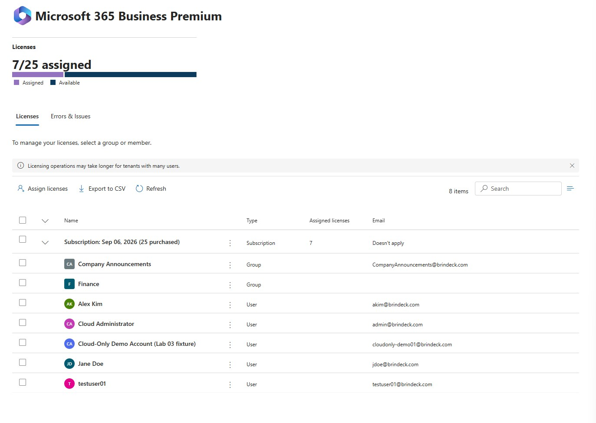
</p>

<p align="center">
  <em>The Business Premium product page's Licenses tab: Company Announcements and Finance both listed as Group-type license holders, 7 of 25 assigned. Captured after John Smith was re-added; the baseline read the identical Group-type listing at 6 of 25.</em>
</p>

Directory audit logs filtered on each group by target surfaced only "Update group" events initiated by `CloudLicensingSystem`, Microsoft's first-party licensing service principal (`MCAPICommercialProductLicensing` user agent), timestamped 9/7 2:58 PM for `Finance` and 9/7 3:21 PM for `Company Announcements`. Neither event's Modified Properties held anything more specific than an empty `Included Updated Properties` string and a `GroupType` value. A filter for a "Remove member from group" activity targeting `John Smith` returned no results, because Microsoft Entra records that activity against the group being changed, not the user being removed. A broader pull across the full week, filtered client-side on both group object IDs, found it: `admin@brindeck.com` removed `John Smith` from `Company Announcements` at 4:03:32 PM on 9/7/2026, through `O365AdminPortal` (see Troubleshooting and Adjustments).

`John Smith` was re-added to `Company Announcements`, and the Business Premium product page confirmed the repair immediately: 7 of 25 assigned. Reassigning membership was sufficient, consistent with Eight-B's finding that group membership alone drives a group-based license.

Deletion was then attempted against `Finance`. It held zero members throughout this step, as it had since Eight-C, but still carried two group-level SKU assignments: Business Premium from Eight-A and Business Basic from Eight-E, as the product page's Group-type listing confirmed. The portal refused the deletion twice in a row with the same generic message: "Failed to delete group. Unable to complete due to service connection error. Please try again later."

<p align="center">
  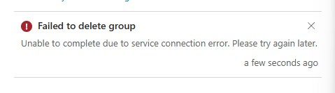
</p>

<p align="center">
  <em>The portal's error toast after the delete attempt: a generic service connection message, no group name or other identifying detail in the frame itself, and no indication of the actual constraint underneath it.</em>
</p>

`Remove-MgGroup -GroupId $fin.Id`, retried after a stale-token `403` was cleared (see Troubleshooting and Adjustments), returned the real error: `400 Request_BadRequest: "A group with active modern licenses assigned cannot be deleted."` Neither Microsoft's group-based licensing documentation nor either admin center's delete confirmation mentions this constraint anywhere this lab looked. `Finance` had no members at all when this ran, so the block is keyed to the group's own active license assignment rather than to whether any member is drawing a license through it. `Company Announcements`'s deletion was not independently tested. It carries an identically active Business Premium assignment and, by the same stated rule, should be blocked the same way; that is an inference rather than a verified result.

<p align="center">
  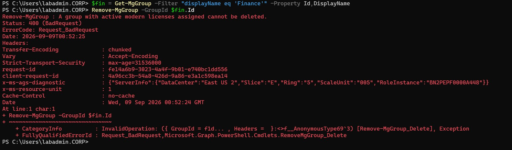
</p>

<p align="center">
  <em>The complete retried Remove-MgGroup -GroupId $fin.Id failure: Status 400 (BadRequest), ErrorCode Request_BadRequest, and the full message text, "A group with active modern licenses assigned cannot be deleted."</em>
</p>

Microsoft Graph's own group-level read cannot see the constraint it is itself enforcing. A raw `Invoke-MgGraphRequest` against each group's `assignedLicenses` property, run well after the repair and a scope reconnect had ruled out staleness and permissions, returned an empty `{}` for both `Finance` and `Company Announcements`, the same result the typed `Get-MgGroup -Property AssignedLicenses` cmdlet had given. The same raw call against `Company Announcements`'s membership correctly returned one member.

<p align="center">
  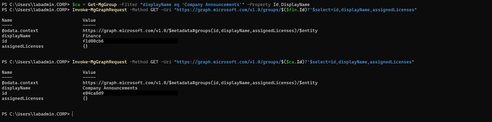
</p>

<p align="center">
  <em>Raw Invoke-MgGraphRequest reads against both groups' assignedLicenses in one frame: {} for Finance and {} for Company Announcements, each group's object ID masked past its first segment in the frame.</em>
</p>

The same gap reaches down to the user. `John Smith`'s own `licenseAssignmentStates`, read the same way, shows the Business Premium SKU as `state: Active`, `error: None`, but `assignedByGroup: null`, exactly the field that would name `Company Announcements` as the source if it were populated.

<p align="center">
  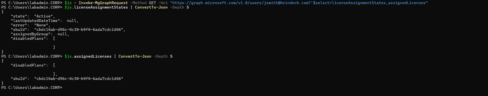
</p>

<p align="center">
  <em>John Smith's licenseAssignmentStates for the Business Premium SKU: Active, no error, but assignedByGroup null, even though the Microsoft 365 admin center and the deletion block both confirm the license is genuinely group-sourced.</em>
</p>

This is left as an open gap rather than a settled explanation. The Microsoft 365 admin center and the deletion block both confirm, independently, that the modern-licensing commerce system tracks the group-to-license relationship and enforces it. Neither directory-side surface agrees: the Entra admin center's group Licenses blade read "No license assignments found" for both groups, and Microsoft Graph's assignedLicenses and licenseAssignmentStates.assignedByGroup properties still read empty and null well after staleness was ruled out. The gap is about those two properties, not about how many seats are consumed, which Part C reconciles. Why the split exists cannot be settled from the outside, and it is recorded as a finding for a later lab or a support case. `Finance` and `Company Announcements` were both left as Step Eight configured them, licensed and undeleted.

**Part B: deleted and restored a disposable cloud-only security group and a disposable cloud-only Microsoft 365 group, and settled the documentation contradiction.**

Two fixtures were built for this test: `zz-delete-test-security`, a cloud-only assigned-membership security group, and `zz-delete-test-m365`, a cloud-only assigned-membership Microsoft 365 group. Neither was ever licensed. `cloudonly-demo01` was added to both as their sole member, as in Nine-B. Both groups were created at 7:15 PM on 9/8/2026; `zz-delete-test-security` came back with zero owners and one direct member, and `zz-delete-test-m365` with one owner and one direct member, because a Microsoft 365 group assigns its creator as owner automatically and a security group does not.

Both were deleted together through the portal at 7:19:17 PM on 9/8/2026, and both appeared on Deleted groups immediately, alongside the tenant's pre-existing `Testgroup`, each with a permanent deletion date of 10/8/2026, 7:19:17 PM, thirty days out as Microsoft documents for a soft-deleted group.

<p align="center">
  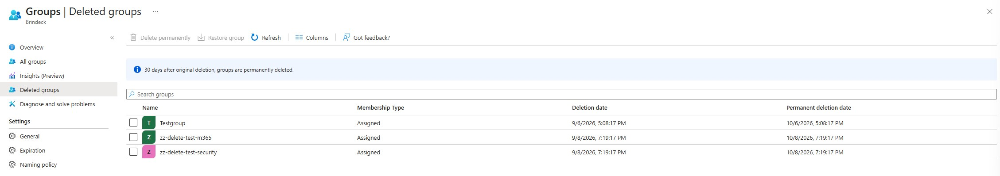
</p>

<p align="center">
  <em>Deleted groups immediately after deletion: zz-delete-test-m365 and zz-delete-test-security alongside Testgroup, each with Membership Type Assigned, deletion date 9/8/2026 7:19:17 PM, and permanent deletion date 10/8/2026 7:19:17 PM. The grid carries no group-type column.</em>
</p>

That screen settles the contradiction. The security group is on Deleted groups, as the recoverability architecture guidance states and contrary to what the PowerShell reference states. Restoring both through the portal brought both back, `cloudonly-demo01`'s Groups blade showed membership restored in both without being re-added, and Deleted groups returned to holding only `Testgroup`. On this tenant, a cloud-only security group soft-deletes and restores with its membership intact, the same as a cloud-only Microsoft 365 group.

The licensing half of the plan, what happens to a group's own license assignments on delete and restore, could not be run: Part A shows that on this tenant a group carrying an active modern license assignment cannot be deleted at all, so there is no cycle for a license to survive or fail.

Both `zz-delete-test-*` groups were permanently deleted once the test concluded, through the portal's bulk permanent-delete action; Deleted groups returned to holding only `Testgroup`.

**Part C: reconciled the seat-count discrepancy between the product page and `Get-MgSubscribedSku`.**

The Business Premium product page reads 7 of 25 assigned. `Get-MgSubscribedSku` reads `ConsumedUnits: 6` for `SkuPartNumber SPB`, against the same 25-seat subscription confirmed since Step Two. Both were read within minutes of each other on 9/8/2026, against the identical tenant state, and they disagree.

<p align="center">
  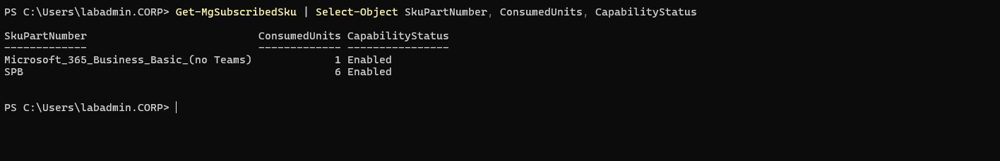
</p>

<p align="center">
  <em>Get-MgSubscribedSku | Select-Object SkuPartNumber, ConsumedUnits, CapabilityStatus, narrowed to omit the Id, AccountId, and SubscriptionIds columns: SPB (Business Premium) at 6 consumed, Microsoft 365 Business Basic (no Teams) at 1, both Enabled.</em>
</p>

The product page's own CSV export resolved it, because the page's rolled-up view nests a group-sourced holder like `John Smith` under `Company Announcements`'s row rather than listing him on his own. The export lists exactly seven rows, every one `Has license: true`:

| Display name | User principal name | Assignee type | Has license | AssignedProductSkus |
|---|---|---|---|---|
| testuser01 | testuser01@brindeck.com | User | true | SPB |
| Cloud-Only Demo Account (Lab 03 fixture) | cloudonly-demo01@brindeck.com | User | true | SPB |
| Cloud Administrator | admin@brindeck.com | User | true | SPB |
| Jane Doe | jdoe@brindeck.com | User | true | SPB |
| Alex Kim | akim@brindeck.com | User | true | SPB |
| Finance | (none) | Group | true | (none) |
| Company Announcements | CompanyAnnouncements@brindeck.com | Group | true | (none) |

(Columns uniform or blank across all seven rows, among them Last name, State or province, City, Job title, and Selected, are omitted. The export's `Object id` column is dropped rather than masked. `John Smith` appears in none of the seven rows, and neither group row carries an `AssignedProductSkus` value of its own.)

Seven rows means seven assignment targets: five licensed users and two licensed groups. `Get-MgSubscribedSku`'s six consumed units means six seats held by a live user, and a raw Graph enumeration of every live user's assigned SKUs finds exactly those six: the same five users, plus `John Smith`, whose seat is sourced through `Company Announcements`. `Company Announcements` resolves to one seat, `John Smith`'s. `Finance`, licensed since Eight-A and Eight-E but holding no members since Eight-C, resolves to none. Seven targets, six seats: the product page counts the former, `Get-MgSubscribedSku` counts the latter, and the one-seat gap is exactly `Finance`'s empty membership.

**Finding one, stated operationally.** The Business Premium product page's assigned count overstates real seat consumption by exactly one for every licensed group that currently holds no members, and this tenant carries exactly one such group. The page counts assignment targets rather than consumed seats, and does not say so anywhere on the page itself.

**Finding two, stated and closed.** A soft-deleted user retains its `assignedLicenses` property intact but consumes no seat toward `Get-MgSubscribedSku`'s count. `nolocation-demo01`, soft-deleted 4:01 PM on 9/7/2026, still carries the SPB SKU on its object per the raw deleted-items read, and appears in neither the product page's seven rows nor `Get-MgSubscribedSku`'s six. `duptest01` and `duptest02` carry nothing on the same read, which leaves Step Twelve a directory-hygiene question about them rather than a licensing one.

One observation does not fit the composition above, and is recorded as unresolved. The same composition, `Company Announcements` and `Finance` both already listed as Group-type rows, produced a 6 of 25 reading on 9/7/2026 and a 7 of 25 reading on 9/8/2026, the only change between the two being `John Smith`'s membership in `Company Announcements`. Under the target-counting basis established above, that should not have moved the count. Either the baseline reading was taken before the page had settled on listing both group rows despite what it displayed, or the page's basis is not purely target-counting in every state it can be in.

### Step Eleven: Established what can and cannot be edited on a synchronized object

A baseline read before anything was touched found the tenant unchanged from Step Ten's close.

Subjects: `mjohnson` (Mary Johnson), a synchronized, unlicensed user with a blank Job title, `Account enabled: Yes`, and existing membership in `Domain-Users-Standard` and `IT-Admins`, both synchronized from Windows Server AD; and `cloudonly-demo01`, license-only with zero group memberships and zero directory role assignments. Because `mjohnson` already belongs to `IT-Admins`, `Lab-Workstations` was used as the synchronized-group refusal target instead.

**Eleven-A: directory attributes are locked per field, not per object, and the one field the portal left open on the Identity tab was the one an administrator would least expect.**

Edit properties on `mjohnson` showed every field on the Job Information tab disabled: Job title, Company name, Department, Employee ID, Employee type, Office location, and the Manager and Sponsors controls, all greyed and unclickable, no save to even attempt. The Identity tab told a different story. Display name, First name, Last name, and User type were disabled the same way, but User principal name rendered as a live, editable field with its own domain dropdown, the only field on either tab the portal left open.

<p align="center">
  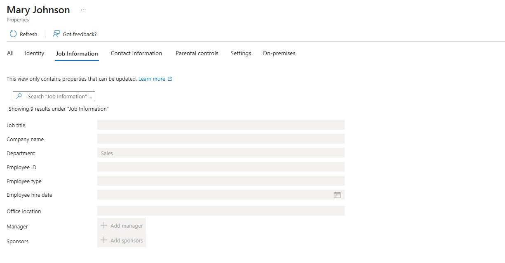
</p>

<p align="center">
  <em>mjohnson's Job Information tab, "Showing 9 results under Job Information": Job title, Company name, Department (holding Sales), Employee ID, Employee type, Employee hire date, and Office location disabled, with Manager and Sponsors as greyed Add controls.</em>
</p>

The Identity tab capture below was taken after the UPN reverted in Eleven-B, which is why User principal name reads `mjohnson` rather than the temporary `mjohnson-test` it held earlier in this step.

<p align="center">
  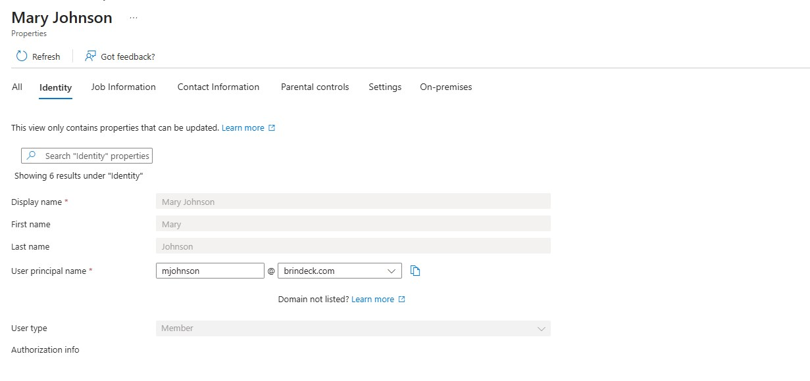
</p>

<p align="center">
  <em>mjohnson's Edit properties view, Identity tab, "Showing 6 results under Identity": Display name (Mary Johnson), First name (Mary), Last name (Johnson), and User type (Member) greyed, and User principal name a live text box reading mjohnson beside an active brindeck.com domain dropdown.</em>
</p>

The lock is enforced per field rather than per object, and the field left open is user principal name, the one a sign-in depends on, not a cosmetic one.

Because the portal locked Job title before any save could be attempted, the refusal was captured at the Microsoft Graph layer. These writes ran after Eleven-B's UPN change, which is why they address the account by its temporary `mjohnson-test@brindeck.com` UPN; the screenshot captures a later re-run after the UPN reverted to `mjohnson@brindeck.com`, with an identical status, error code, and message:

```powershell
Update-MgUser -UserId "mjohnson-test@brindeck.com" -JobTitle "Cloud Write Test"
```

```
Update-MgUser : Unable to update the specified properties for on-premises mastered Directory Sync objects or objects currently undergoing migration.
Status: 400 (BadRequest)
ErrorCode: Request_BadRequest
```

<p align="center">
  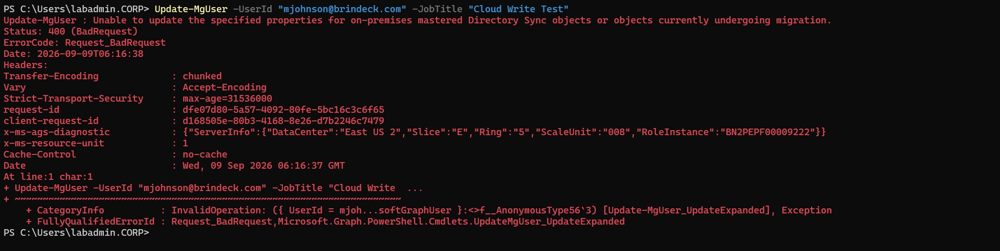
</p>

<p align="center">
  <em>Update-MgUser -UserId "mjohnson@brindeck.com" -JobTitle "Cloud Write Test" re-run after the UPN reverted: Status 400 (BadRequest), ErrorCode Request_BadRequest, and the message naming on-premises mastered Directory Sync objects, with the request-id and client-request-id correlation identifiers in full, as in screenshot 31.</em>
</p>

The message names the constraint by category, directory sync objects, rather than returning a bare permissions error. The identical write against `cloudonly-demo01` succeeded silently and read back as set:

```powershell
Update-MgUser -UserId "cloudonly-demo01@brindeck.com" -JobTitle "Cloud Write Test"
Get-MgUser -UserId "cloudonly-demo01@brindeck.com" -Property JobTitle | Select-Object JobTitle
```

```
JobTitle
--------
Cloud Write Test
```

The historical `mobile` and `otherMobile` exception, which Microsoft's own `BypassDirSyncOverridesEnabled` documentation records as no longer applying, did not hold on this tenant either. The identical write against `mjohnson`,

```powershell
Update-MgUser -UserId "mjohnson-test@brindeck.com" -Mobile "555-0100"
```

returned the same error, status, error code, and message text. That is consistent with the tenant's configuration read in Eleven-B: `BypassDirSyncOverridesEnabled`, the flag that would let Mobile and OtherMobile persist independently of on-premises AD, read `False`.

**Eleven-B: the UPN write the portal allowed actually landed on the object, persisted through a completed synchronization cycle, and is explained by a tenant-level feature flag rather than left as a bare surprise.**

Changing `mjohnson`'s UPN from `mjohnson@brindeck.com` to `mjohnson-test@brindeck.com` through Edit properties, saved at 12:56 AM EDT, returned "Successfully updated user" rather than the refusal Job title and Mobile had just returned.

<p align="center">
  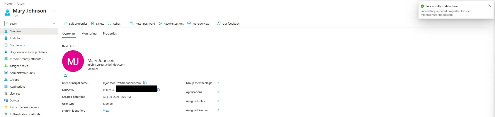
</p>

<p align="center">
  <em>mjohnson's Overview immediately after the UPN edit: "Successfully updated user" toast, and the page itself now reading mjohnson-test@brindeck.com throughout.</em>
</p>

A Graph read-back confirmed the change had actually reached the directory object rather than only a portal toast:

```powershell
Get-MgUser -UserId "mjohnson-test@brindeck.com" -Property UserPrincipalName | Select-Object UserPrincipalName
```

```
UserPrincipalName
------------------
mjohnson-test@brindeck.com
```

Microsoft documents a per-tenant directory synchronization feature that governs UPN synchronization for managed, non-federated users. Current Microsoft Learn documentation names the cmdlet `Get-MgDirectoryOnPremiseSynchronization` and the property `Features.SynchronizeUpnForManagedUsersEnabled`. Reading it against this tenant:

```powershell
Connect-MgGraph -Scopes "OnPremDirectorySynchronization.Read.All", "User.Read.All"
$DirectorySync = Get-MgDirectoryOnPremiseSynchronization
$DirectorySync.Features | Format-List
```

returned `SynchronizeUpnForManagedUsersEnabled: True`, alongside `BypassDirSyncOverridesEnabled: False` (the Eleven-A finding above) and `SoftMatchOnUpnEnabled: True`.

<p align="center">
  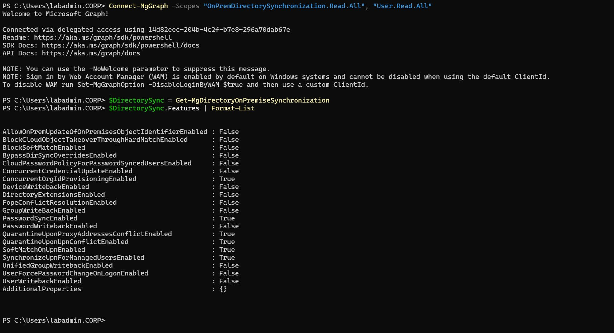
</p>

<p align="center">
  <em>Get-MgDirectoryOnPremiseSynchronization's Features list in full: SynchronizeUpnForManagedUsersEnabled and SoftMatchOnUpnEnabled both True, BypassDirSyncOverridesEnabled False, alongside the tenant's other default feature settings.</em>
</p>

`mjohnson` meets both conditions Microsoft's documentation attaches to this feature, managed (nonfederated) and unlicensed. That explains why an on-premises UPN change is allowed to flow up to the cloud; it does not by itself explain why a cloud-first change was accepted and kept standing, which is what the round trip tested.

The Synchronization Service Manager's operations log showed a natural Delta cycle had run since the 12:56 AM EDT UPN save: `corp.home.arpa` Delta Import starting 1:07:55 AM, `brindeck.onmicrosoft.com` Delta Synchronization completing 1:08:43 AM, and the Export to `brindeck.onmicrosoft.com` succeeding from 1:08:50 to 1:08:56 AM (screenshot 42, in Eleven-E). The UPN change survived that unforced cycle, and still read `mjohnson-test@brindeck.com` after the forced cycle in Eleven-E, which carried `mjohnson`'s Job title in the same run and so was not a no-op.

The standard explanation is that a delta cycle reasserts only attributes with a detected inbound change, and the on-premises `userPrincipalName` attribute was never touched. That is textbook delta behavior, not a result this step tested. Confirming it would need a Full Synchronization, or an on-premises UPN change watched overwriting the cloud value the way Job title did in Eleven-E, and neither was run, so the mechanism is recorded as the working explanation for a later lab to confirm.

The UPN was then reverted manually in the portal to `mjohnson@brindeck.com`, as decided before the test, and confirmed on her Overview page. This was a manual fix, not a synchronization outcome.

**Eleven-C: group membership confirmed both directions of the same asymmetry on one user, and the refusal surfaced before any add could be attempted.**

Adding `mjohnson` to `All Company`, the tenant's cloud-only, unlicensed, assigned-membership group, succeeded immediately: "Successfully added group membership." Attempting the opposite direction, adding her to `Lab-Workstations`, a synchronized group, showed the constraint enforced directly in the Select groups picker rather than as a save-time error: every synchronized group in the list, `Domain-Users-Standard`, `IT-Admins`, `Lab-Workstations`, and `Linux-Admins`, appeared greyed with "Directory synced objects are not allowed." beside its name, unselectable. `IT-Department` carried its own separate reason, "Dynamic groups are not allowed.", confirming that constraint too rather than only the one this test targeted.

<p align="center">
  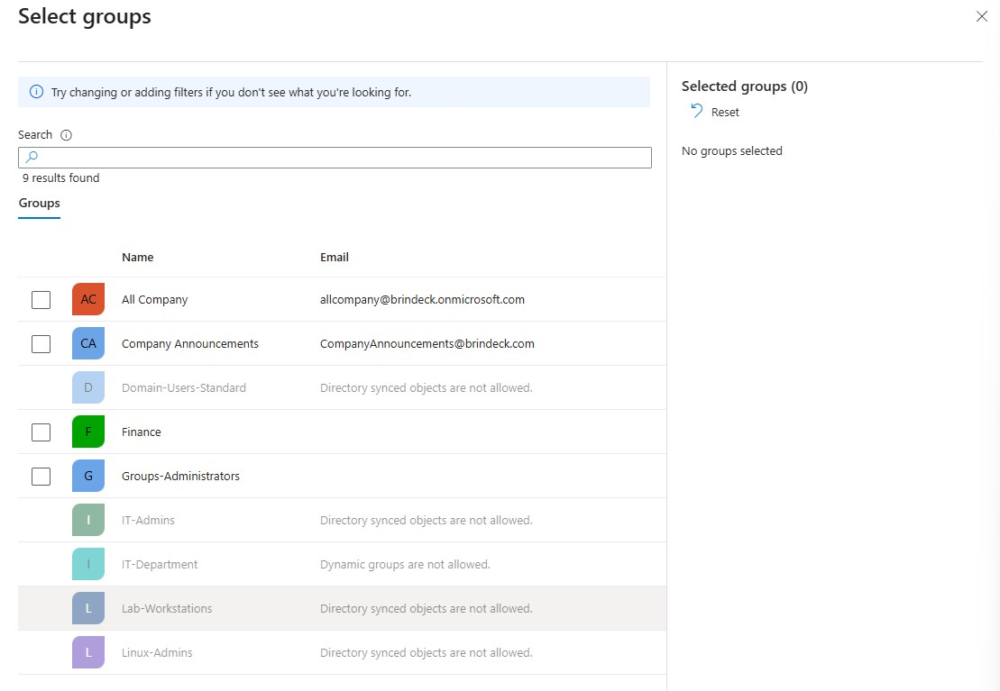
</p>

<p align="center">
  <em>The Select groups picker for mjohnson: All Company and Company Announcements selectable, Finance and Groups-Administrators selectable, while Domain-Users-Standard, IT-Admins, Lab-Workstations, and Linux-Admins each read "Directory synced objects are not allowed." and IT-Department reads "Dynamic groups are not allowed.", every one of those five greyed and unselectable for its own stated reason.</em>
</p>

Both results ran against the same user, so the constraint belongs to the group's source of authority rather than the user's: the same `mjohnson` could join a cloud-only group and could not even attempt to join a synchronized one. She was removed from `All Company` once the evidence was captured.

**Eleven-D: account enabled state is cloud-writable on a synchronized user, another field on the "open" side of the per-field lock.**

Disabling and re-enabling `cloudonly-demo01` through Edit properties' Account enabled checkbox succeeded both directions, "Successfully updated user" each time. The identical toggle against `mjohnson` also succeeded both directions, each confirmed with a fresh "Successfully updated user" notification and the checkbox state itself. Account enabled joins user principal name as a field the portal leaves writable on a synchronized object.

This demonstrated writability, not durability. `accountEnabled` synchronizes from `userAccountControl` in Active Directory, and Eleven-B's mechanism predicts a cloud-side disable would stand only until a synchronization cycle carries an on-premises change to that account's enabled state. No such cycle ran between the disable and the re-enable, so whether disabling a synchronized user in the cloud actually holds is left open for a later lab.

**Eleven-E: the refused Job title write was made on-premises instead, and the round trip was timed rather than described.**

With `Get-ADSyncScheduler` already confirming `SyncCycleEnabled: True`, `mjohnson`'s Job title was set on-premises:

```powershell
Set-ADUser -Identity mjohnson -Title "IT Support Specialist"
```

run at 1:17:00 AM EDT. A Delta cycle was forced immediately afterward with `Start-ADSyncSyncCycle -PolicyType Delta` on `SYNC01`. The Synchronization Service Manager's operations log gave second-level timing: Delta Import on `corp.home.arpa` started 1:20:58 AM, Delta Synchronization against `brindeck.onmicrosoft.com` finished 1:21:47 AM, and the Export to `brindeck.onmicrosoft.com` succeeded from 1:21:55 AM to 1:22:01 AM, the step where the change reached the tenant.

<p align="center">
  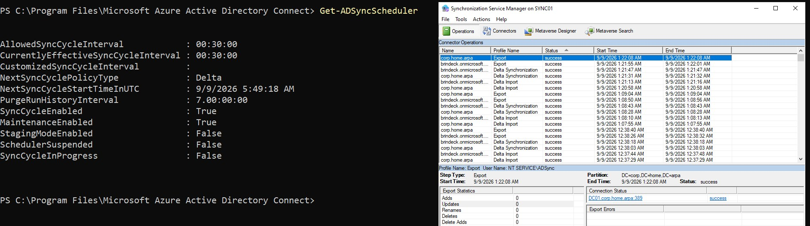
</p>

<p align="center">
  <em>Get-ADSyncScheduler and the Synchronization Service Manager's Connector Operations log on SYNC01 in one frame. Left: SyncCycleEnabled True, a thirty-minute effective interval, next cycle due 9/9/2026 5:49:18 AM UTC. Right, both cycles this step relied on: the natural Delta cycle running corp.home.arpa Delta Import 1:07:55 AM through the corp.home.arpa Export at 1:09:04 AM, and the forced cycle running corp.home.arpa Delta Import 1:20:58 AM, brindeck.onmicrosoft.com Delta Synchronization completing 1:21:47 AM, the brindeck.onmicrosoft.com Export succeeding 1:21:55 to 1:22:01 AM, and the corp.home.arpa Export closing at 1:22:08 AM.</em>
</p>

From the 1:17:00 AM on-premises write to the 1:22:01 AM cloud-side export completing, the round trip measured 5 minutes 1 second. `mjohnson`'s Job Information tab confirmed the arrival directly: Job title now read `IT Support Specialist`, Department still `Sales`, unchanged.

<p align="center">
  
</p>

<p align="center">
  <em>mjohnson's Job Information tab after the Delta cycle: Job title reading IT Support Specialist, Department unchanged at Sales.</em>
</p>

`title` stays set on `mjohnson` permanently, as Step Six's `department` values do; this domain's `Title` attribute had no populated values before this lab.

**Restoration.** `mjohnson` ended this step a member of exactly `Domain-Users-Standard` and `IT-Admins`, `Account enabled: Yes`, and UPN back at `mjohnson@brindeck.com`, with her Job title deliberately left at `IT Support Specialist`. `cloudonly-demo01` had its test Job title cleared, and its Groups blade read "Not a member of any groups" and Assigned roles "No directory roles assigned.", license-only exactly as it started.

### Step Twelve: Validated the environment is otherwise unchanged, settled the SSO key, and recorded the finished state

Confirmed that a lab conducted almost entirely in two web portals left the on-premises environment as it found it, and recorded the state Lab 04 starts from.

**Drift check.** `mjohnson`'s Overview, Job Information, and Groups tabs matched Step Eleven's Restoration paragraph: UPN `mjohnson@brindeck.com`, `Account enabled: Yes`, Job title `IT Support Specialist`, and membership in exactly `Domain-Users-Standard` and `IT-Admins`.

<p align="center">
  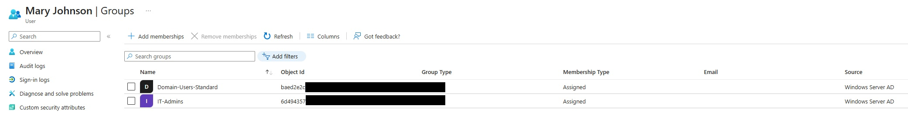
</p>

<p align="center">
  <em>mjohnson's Groups blade: exactly Domain-Users-Standard and IT-Admins, both group object IDs masked.</em>
</p>

`cloudonly-demo01` matched too: zero group memberships, zero assigned roles, one assigned license (SPB), Job title cleared back to blank.

<p align="center">
  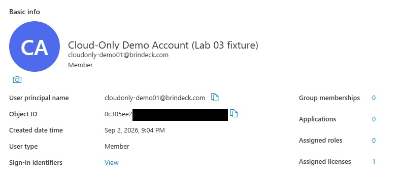
</p>

<p align="center">
  <em>cloudonly-demo01's Overview: Group memberships 0, Applications 0, Assigned roles 0, Assigned licenses 1, object ID masked.</em>
</p>

**On-premises and synchronization.** `Test-ComputerSecureChannel` from WIN11-CLIENT01 returned `True`. `gpresult /r /scope:computer` showed `Workstation-Security-Baseline` and `Default Domain Policy`, and a full `gpresult /r` for `CORP\labadmin`, a member of `IT-Admins` in `OU=IT`, confirmed `IT-Admin-Environment` under User Settings (see Troubleshooting and Adjustments). `sssd` was `active (running)` on Ubuntu Server, and a fresh `kinit testuser01@CORP.HOME.ARPA` produced a ticket bracketing the current time.

`SYNC01` had been suspended between lab sessions, and it surfaced this step's most substantial finding. `Get-ADSyncScheduler` read `SyncCycleEnabled: True` and `SchedulerSuspended: False`, but `NextSyncCycleStartTimeInUTC` at `9/9/2026 3:31:00 PM`, two days stale, and the Synchronization Service Manager's Operations tab confirmed no cycle had run since then, 1,374 runs total, all `success`. The `ADSync` service was `Running`, and the Windows Application event log showed it acquiring MSAL tokens against `AdminWebService` moments before the check: alive, but not re-arming its own scheduler after the suspend. No Task Scheduler entry matched `ADSync` or `Azure AD Sync` (only an unrelated `TouchpadSyncDataAvailable` task matched the name filter), so the scheduler runs as an in-process timer inside the `ADSync` service. `Restart-Service ADSync` did not correct it: `Get-ADSyncScheduler` still read `9/9/2026 3:31:00 PM` three minutes later. A full VM restart did: the next read gave `NextSyncCycleStartTimeInUTC: 9/11/2026 11:23:27 PM`, roughly the correct half hour out, nothing suspended. No cycle was forced manually at any point. Nothing was missed in the roughly two-day gap, since no lab work ran against either directory while `SYNC01` sat suspended. This is recorded as a carry-forward item for this track's close-out to propagate into the `README`: a session that resumes a suspended `SYNC01` should expect the same stale scheduler, which a service restart will not correct and a full VM restart will.

<p align="center">
  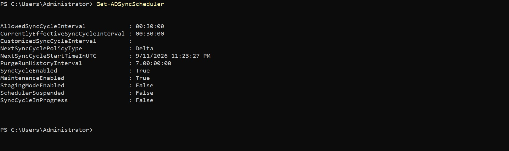
</p>

<p align="center">
  <em>Get-ADSyncScheduler after the SYNC01 VM restart: NextSyncCycleStartTimeInUTC recalculated to 9/11/2026 11:23:27 PM, SyncCycleInProgress False, nothing suspended.</em>
</p>

The Entra Connect version and source anchor were unchanged: `Microsoft Entra Connect Sync 2.6.84.0` in the uninstall list (distinct from `Microsoft Azure AD Connect Agent Updater`, a different component with its own version number), and the wizard's "View current configuration" page still read `mS-DS-ConsistencyGuid` as source anchor, the attribute that survives an on-premises object being deleted and recreated, unlike `objectGUID`.

**Wazuh.** `Invoke-LabHealthReport.ps1`'s `WazuhAgentStatus` check queried only `DC01`, `WIN11-CLIENT01`, and `UBUNTU-SERVER`, its hardcoded default from Automation Lab 05, all `active`, and returned `Overall: Healthy` without asking about `SYNC01`. The explicit call, `Get-LabWazuhAgentStatus -AgentName DC01,WIN11-CLIENT01,UBUNTU-SERVER,SYNC01`, showed all four `active`/`Healthy`, `SYNC01` included. The default script's green result was correct by coincidence, since it structurally excludes the one host this track's synchronization depends on.

<p align="center">
  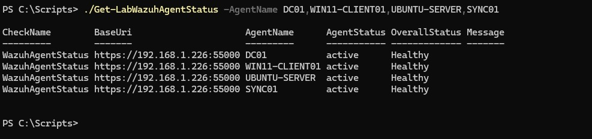
</p>

<p align="center">
  <em>Get-LabWazuhAgentStatus called explicitly with SYNC01 added to the default agent list: all four hosts active and Healthy.</em>
</p>

**Automation library.** `Invoke-Pester -Path C:\Scripts -Output Detailed` completed in 39.37 seconds: 174 tests passed, 0 failed, 0 skipped, 0 not run, unchanged, since no script is touched by this lab.

<p align="center">
  
</p>

<p align="center">
  <em>Invoke-Pester summary: 174 tests passed, 0 failed, 0 skipped, 0 not run.</em>
</p>

**The `AZUREADSSOACC` key.** A fresh `Get-ADComputer AZUREADSSOACC -Properties PasswordLastSet` read on `SYNC01` returned `8/31/2026 8:07:44 PM`, unchanged from Step One: eleven days elapsed as of this step, well short of the thirty the interval names.

<p align="center">
  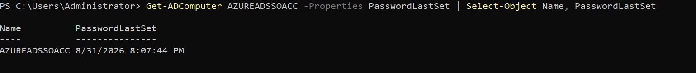
</p>

<p align="center">
  <em>Get-ADComputer AZUREADSSOACC -Properties PasswordLastSet, re-read on SYNC01 so the elapsed interval spans this step: 8/31/2026 8:07:44 PM, unchanged from Step One.</em>
</p>

Microsoft Learn's current wording is consistent across its Quickstart, Technical Deep Dive, and FAQ articles: "we highly recommend" rolling the key "at least every 30 days." None of them describe the key as expiring, and Defender for Identity's automated security assessment for this account does not flag it until the password is over ninety days old, not thirty. Thirty days is a hygiene interval, not an operational deadline the key stops functioning at. The decision taken was not to roll the key in this step: eleven days is well short of thirty, rolling now would only repeat the demonstration Lab 02's Step Eight-A already gave, and it would erase the chance to watch a full thirty-day interval elapse on 2026-09-30 (2026-10-01 in UTC), which a later lab is meant to observe.

**Finished state.** The Entra Overview read 10 users, unchanged from Step One, and 9 groups: Step One's 5 (the four groups synchronized from `OU=Groups` plus `All Company`), plus `Finance`, `Company Announcements`, and the dynamic membership group `IT-Department` from Step Six and the role-assignable group `Groups-Administrators` from Step Seven. On-premises, `(Get-ADUser -Filter *).Count` returned 12: the six synchronized users in `OU=User Accounts` (`akim`, `jdoe`, `jsmith`, `mjohnson`, `tsync01`, and `testuser01`), plus `Administrator`, `Guest`, and `krbtgt` (built-in), `labadmin` (the `IT-Admins` admin account in `OU=IT`), `svc-entraconnect` (the Entra Connect service account in its own `OU=Service Accounts`), and `Test NoSync` (`tnosync01`, deliberately placed in `OU=IT` as this track's fixture proving synchronization's OU scoping). `deltest01`, created and permanently destroyed in Step Nine, nets to zero on both sides, at the cost of two distinct Entra object GUIDs along the way. The two on-premises attribute changes, `department` from Step Six and `mjohnson`'s `title` from Step Eleven, persist as deliberate content.

Business Premium (SPB) remained at 7 assignment targets against `Get-MgSubscribedSku`'s 6 consumed seats, 25 enabled, `Finance`'s empty membership accounting for the gap as Part C established. Business Basic (no Teams) showed a second, independent instance of Part C's finding: the product page read 2 of 25 assigned against `Get-MgSubscribedSku`'s 1 consumed, and the export identified the two assignment targets as `Finance` (still empty) and `Adam Ramzi`. It carries the same unexplained movement. `Finance` became a Business Basic assignment target in Eight-E, so under a target-counting basis the page should have read 2 of 25 from that moment; Step Eight's final state records 1 of 25, and nothing between that reading and this one added a target. That is the same shape as the Business Premium page moving from 6 to 7, and it is recorded as unresolved in the same way.

<p align="center">
  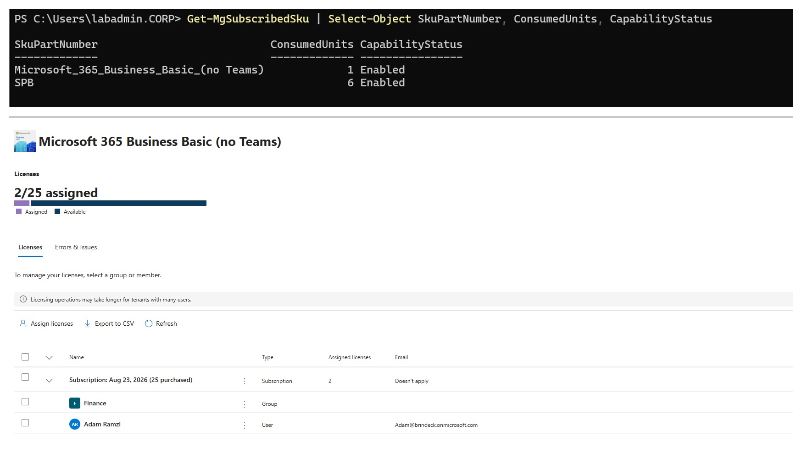
</p>

<p align="center">
  <em>Get-MgSubscribedSku narrowed to SkuPartNumber, ConsumedUnits, and CapabilityStatus, paired with the Business Basic (no Teams) product page: 2 of 25 assigned against 1 consumed, Finance and Adam Ramzi the two assignment targets.</em>
</p>

The Business Basic trial's expiration read `9/22/2026`. Microsoft Entra ID P1 is carried entirely by the Business Premium trial, so it lapses with that trial on 2026-10-05 and takes dynamic membership evaluation, role-assignability, and group-based licensing with it. Microsoft Entra ID Free remained on the Your products page as its own non-assignable line throughout, and is what the tenant falls back to.

Four objects invisible to the Entra Overview's counts were each decided. `nolocation-demo01` (soft-deleted 9/7/2026 4:01 PM, permanent deletion 10/7/2026 4:01 PM) was left for Labs 04 and 05 to inherit: it is the concrete object behind Part C's Finding Two. `duptest01` and `duptest02` (both soft-deleted 9/2/2026 9:41 PM, permanent deletion 10/2/2026 9:41 PM), which Step Ten confirmed hold no licenses, were purged permanently, which makes Lab 02's "left no residue" claim true rather than handing the discrepancy to a later lab. `Testgroup` (soft-deleted 9/6/2026 5:08:17 PM, permanent deletion 10/6/2026 5:08:17 PM), which predates this lab and was never touched or explained by any step in it, was left for Labs 04 and 05 to inherit: its original composition and purpose are unknown, so there was no basis to restore it or to purge it.

<p align="center">
  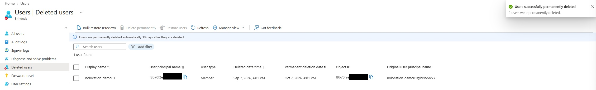
</p>

<p align="center">
  <em>Deleted users after the permanent purge of duptest01 and duptest02: only nolocation-demo01 remains, both identifying values masked.</em>
</p>

Deleted groups still held exactly `Testgroup`, unchanged and untouched, closing the reconciliation.

---

## Validation

Each item maps to an objective above, with the step it was observed in. Two planned items could not be performed as written, and both are recorded as they happened.

- **Licensing.** Met, in Steps Two to Four. The Business Premium trial started without a second-trial refusal, with 25 licenses; its end date read 10/5/2026 on the Expiration date field and in Your products, and "Expires on October 6, 2026" in Recurring billing. Recurring billing was turned off in Step Three, and the Business Basic trial's 9/22/2026 expiration was re-read in Step Twelve. The tenant's plan read Entra ID Premium P1, and `AAD_PREMIUM`, `EXCHANGE_S_STANDARD`, and `INTUNE_A` were confirmed by name with `Get-MgSubscribedSku`. Security defaults stayed enabled and no step created, modified, or evaluated a conditional access policy.
- **Synchronized versus cloud-only editing.** Met in Step Eleven, where the comparison was recorded across Eleven-A through Eleven-E. Job title and Mobile writes on `mjohnson` were refused with Status 400 `Request_BadRequest` and a message naming on-premises mastered Directory Sync objects; the same Job title write succeeded on `cloudonly-demo01`. The lock was per field, with user principal name and account enabled writable in the cloud.
- **Group catalogue and `All Company`.** Met, with one sub-question unanswerable, in Step Six. All nine groups at the close are accounted for by type, membership type, source, and administration point. `All Company` is a cloud-sourced Microsoft 365 group with Assigned membership whose only member is Adam Ramzi; its origin could not be settled because audit retention did not reach its creation date.
- **First cloud-only groups.** Met, in Step Six. `Finance` and `Company Announcements` were created, and their Properties and Members pages compared against `IT-Admins`, whose fields were greyed behind the "Some groups can't be managed in the Azure portal" banner and whose membership showed three of four with no indication it was partial.
- **Dynamic membership.** Met, in Step Six. `department` synchronized without a custom rule, `IT-Department` evaluated `(user.department -eq "IT")`, and the on-premises-to-cloud round trip took 4 minutes 35 seconds to 5 minutes 34 seconds. `dsacls` showed SELF holds no write on `department`'s Public-Information property set. `New-LabUser.ps1`'s gap was left as a Lab 06 candidate.
- **License assignment models.** Partially met, in Steps Five and Eight. Direct assignment ran against five accounts with no difference between object types, and group-based licensing granted and revoked a license by membership alone, with the documented move order producing no interruption. No license assignment error was induced by any of three routes; deleting `nolocation-demo01` produced a partial failure to unassign its group-inherited licenses instead.
- **Directory roles.** Met, in Step Seven. License Administrator on `testuser01` removed and restored a license in the Microsoft 365 admin center, and its apparent group-creation ability traced to tenant self-service settings rather than the role. None of the tenant's eight existing groups could hold a role; `Groups-Administrators`, role-assignable from creation, holds Groups Administrator at Directory scope.
- **Delete and restore users.** Met, in Step Nine. `cloudonly-demo01` was restored with its license, `All Company` membership, and License Administrator assignment intact. `deltest01`, deleted only in the cloud, was restored by a scheduled cycle within eighteen to twenty-seven minutes; deleted on-premises with no Recycle Bin, it was terminal, and its recreation provisioned an unrelated cloud object.
- **Delete and restore groups.** Met, in Step Ten. A cloud-only security group and a cloud-only Microsoft 365 group both appeared on Deleted groups and restored with membership intact, so the recoverability architecture guidance held and the Entra PowerShell reference did not. Licensed groups could not be deleted at all (Part A), so a group license assignment's fate on delete and restore was not observable.
- **Environment unchanged.** Met for every host and service except the synchronization scheduler, which was found stale after a VM suspend and repaired by a VM restart in Step Twelve. Secure channel, Group Policy, SSSD and Kerberos, Entra Connect Sync 2.6.84.0, `mS-DS-ConsistencyGuid`, all four Wazuh agents by explicit list, and 174 of 174 Pester tests read as documented. The only on-premises directory changes are `department` on six users, `title` on `mjohnson`, and `deltest01`, created and destroyed.
- **Seamless SSO key.** Met, in Steps One and Twelve. `PasswordLastSet` read 8/31/2026 8:07:44 PM both times, eleven days elapsed. Microsoft's wording and Defender for Identity's ninety-day threshold characterize thirty days as a hygiene interval, and the key was deliberately not rolled.

---

## Troubleshooting and Adjustments

### The planned pre-assignment service plan check does not exist in either admin center's UI

Step Four's plan called for reading Business Premium's service plans by name from the Microsoft 365 admin center before any license was assigned. Neither the Your products subscription page nor the Billing, Licenses page exposes that breakdown; both stop at license counts (0 of 25 assigned), with no Apps or service-plan tab reachable. Microsoft Entra ID P1 was confirmable from the Entra admin center, but Exchange Online Plan 1 and Microsoft Intune Plan 1 have no Entra-side equivalent, so the check moved to `Get-MgSubscribedSku`, which reads a SKU's service plans regardless of assignment state.

### A membership change after Step Eight closed went unrecorded

`John Smith`'s licensing through `Company Announcements`, as Step Eight's final state recorded it, held only until 4:03:32 PM on 9/7/2026, when `admin@brindeck.com` removed `John Smith` from `Company Announcements` through the `O365AdminPortal`. The lab did not record that action at the time because it happened after Step Eight closed. It surfaced when Step Ten's baseline read found `Company Announcements` back to zero members and `John Smith`'s license unchecked. Step Ten re-added the membership and confirmed the license reasserted before its own work continued. Step Eight's final state is left as written, because it accurately described the tenant at the moment the step closed.

### Reading a soft-deleted user's `assignedLicenses` took two false starts

Nine-A's first read, `Get-MgDirectoryDeletedItem -DirectoryObjectId microsoft.graph.user -Property '*'`, returned `nolocation-demo01` by userPrincipalName, but every extended property, including `deletedDateTime`, came back blank, not merely `assignedLicenses`, which was the first sign the `-Property` parameter was not reaching the request. A raw `Invoke-MgGraphRequest -Method GET` against `/directory/deletedItems/microsoft.graph.user` with an explicit `$select` produced the same blank read on the first attempt and then, unexplained, a fully populated one on a second identical call. Nothing about the request changed between the two, so the interceding delay is the more likely explanation than anything about the query itself.

### `Remove-MgGroup` returned a stale-token `403` before it returned the real error

The first attempt to delete `Finance` with `Remove-MgGroup -GroupId $fin.Id`, bypassing the portal's generic "service connection error," failed with `403 Authorization_RequestDenied`. That read at first like a missing directory role. `Get-MgUserMemberOf -UserId admin@brindeck.com` confirmed Global Administrator on the signed-in account, and `Get-MgContext | Select-Object -ExpandProperty Scopes` showed a working scope set already in place, `Directory.ReadWrite.All` among them, which left the token itself as the explanation. A `Disconnect-MgGraph` followed by a fresh `Connect-MgGraph` against explicit scopes turned the retry into the real `400 Request_BadRequest` "active modern licenses" error Step Ten's Part A is built on.

### `Get-MgGroup -Property AssignedLicenses` and `Get-MgGroupMember` returned blank on real, populated groups

Once `Finance` and `Company Announcements` were repaired and re-licensed in Step Ten, `$fin.AssignedLicenses` and `Get-MgGroupMember -GroupId $fin.Id` (and the same pair against `Company Announcements`) returned empty results repeatedly, across a nine-minute wait, a `Format-List` check confirming both variables held real non-null objects, and a full `Disconnect-MgGraph`/reconnect with `Group.Read.All` and `GroupMember.Read.All` added explicitly. A raw `Invoke-MgGraphRequest` against the same properties, the same fix Nine-A used, returned real data immediately: `Company Announcements`'s membership call correctly showed `John Smith`. The license read stayed `{}` for both groups, which Step Ten established by other means as a platform gap rather than a query defect. The `-Property` parameter did reach the request cleanly against a live user addressed by id in Eleven-B, so the gap is specific to a deleted item and to a group, not a general defect in the parameter.

### A blank-looking audit log initiator was a PowerShell truthiness bug, not a real gap in the log

An early script projecting each Step Ten audit event's initiator with `if ($_.InitiatedBy.App) { $_.InitiatedBy.App.DisplayName } else { $_.InitiatedBy.User.UserPrincipalName }` showed blank actors for events that Correlation IDs and timestamps confirmed were real. `$_.InitiatedBy.App` is a non-null object even when every field on it is null, so the condition evaluated true and the script read a null `DisplayName` instead of falling through to the populated `User` branch. Dumping the same event with `ConvertTo-Json -Depth 10` showed the actual initiator immediately, `CloudLicensingSystem` in every case that mattered here.

### A computer-scoped Group Policy result briefly read as drift

Step Twelve's first pass at the Group Policy result, `gpresult /r /scope:computer`, showed only `Workstation-Security-Baseline` and `Default Domain Policy`, with no `IT-Admin-Environment`. `IT-Admin-Environment` is a User Configuration policy security-filtered to `IT-Admins` membership, so a computer-scoped result can never show it regardless of whether it applies. A full `gpresult /r` for `CORP\labadmin` confirmed it under User Settings.

### Ubuntu Server's cached Kerberos ticket was seven days expired

Step Twelve's `klist` on Ubuntu Server showed `testuser01@CORP.HOME.ARPA` valid `09/03/2026 13:15:55` to `09/03/2026 23:15:55`, left over from the day the service last started rather than a currently valid ticket. A fresh `kinit` produced a current one. The stale ticket and a nine-second `sssd_be` offline/online pair logged at the moment of testing both traced to the VM having been suspended between lab sessions and only just resumed, not to a connectivity fault.

### Restarting the `ADSync` service does not fix a scheduler left stale by a VM suspend

Step Twelve records the diagnosis. The procedural point is that `Restart-Service ADSync` does not reset the in-process timer state a VM suspend leaves behind, and a full VM restart does, confirmed by testing both in sequence.

---

## Security Considerations

- **The tenant acquires a paid identity tier, and with it capabilities that are not turned on.** Conditional access becomes available in Step Two and is deliberately not used. An administrator who assumes conditional access is protecting the tenant because the entitlement is present would be wrong: security defaults remains the only thing enforcing multifactor authentication until Lab 05 changes that deliberately.
- **The entitlement is temporary, and what depends on it is not.** Dynamic membership groups and role-assignable groups are configured on an entitlement that expires, and Labs 04 and 05 inherit what happens to them when the trial lapses. A group whose membership stops evaluating without announcing it is the same silent degradation this repository has documented in Linux Lab 06's monitoring gap and Lab 02's disabled scheduler.
- **Dynamic membership groups move an access-control decision onto an attribute.** Whoever can write the attribute can change the group's membership, and therefore anything the group grants. In a hybrid tenant that write permission may live in Active Directory and may belong to the user. Step Six's check constrains what Lab 05 may safely target with conditional access.
- **Role-assignable groups are the same problem with the product's own answer.** Microsoft requires assigned membership on any group that can hold a role assignment, so that a role cannot be acquired by editing an attribute.
- **Deletion in a hybrid tenant has a correct place and an incorrect one.** Deleting a synchronized user in the cloud looks like it worked and may be undone by the next synchronization cycle. That is an inconsistency between what the administrator did and what the directory believes, not a safety net, and the only correct deletion path for a synchronized object is at its source.
- **Every account licensed in this lab gains a cloud-reachable, mailbox-capable identity.** Accounts that existed only as directory objects can now sign in to Microsoft 365 services from the public internet, with security defaults' tenant-wide multifactor authentication requirement in front of them, which is another reason it is not disabled here.
- **The `AZUREADSSOACC` key is the environment's least visible standing risk.** If leaked, it can generate Kerberos tickets for any synchronized user and impersonate their Microsoft Entra sign-ins. Nothing rotates it automatically and nothing alerts when it ages. This lab establishes the ongoing obligation, the prerequisite for Lab 06 deciding whether to automate it.
- **A trial with recurring billing enabled is a financial exposure, not just an administrative one.** The default behavior charges, and a thirty-day gap between the action and its consequence is exactly the interval at which a person stops thinking about it.

---

## Outcome

This lab was the first in the track to operate the hybrid environment rather than build it. Nothing was deployed and no topology changed. The tenant moved from Microsoft Entra ID Free to Microsoft Entra ID Premium P1, carried by a Business Premium trial whose `AAD_PREMIUM`, `EXCHANGE_S_STANDARD`, and `INTUNE_A` plans make this lab's P1 work, Lab 04's mailboxes, and Lab 05's device management a single subscription. Security defaults remains enabled and no conditional access policy exists.

Licensing ends in two shapes that do not agree by arithmetic and are both correct. Business Premium stands at seven assignment targets against six consumed seats, out of 25 enabled: five directly licensed users, Alex Kim, the Cloud Administrator, `cloudonly-demo01`, Jane Doe, and `testuser01`, and two groups, with `John Smith`'s seat sourced through `Company Announcements` and `Finance` licensed but empty. Business Basic (no Teams) shows the same pattern: two targets, `Finance` and the signup account, against one consumed seat.

Nine groups persist against a baseline of five. The four this lab created persist as content: `Finance`, carrying both SKUs at the group level and no members; `Company Announcements`, carrying Business Premium with `John Smith` as its member; `IT-Department`, on `(user.department -eq "IT")` with five members; and `Groups-Administrators`, holding Groups Administrator at Directory scope. `testuser01` retains License Administrator at Directory scope. Both licensed groups are undeletable while those assignments stand, a constraint Lab 04 inherits. `nolocation-demo01` and `Testgroup` remain soft-deleted for Labs 04 and 05; `duptest01` and `duptest02` were purged. On-premises, `department` on the six synchronized users and `title` on `mjohnson` persist as content, and everything else is as Lab 02 left it, with the scheduler back on its half-hourly Delta cycle.

Lab 04 inherits three dates. On 2026-09-22 the Business Basic (no Teams) trial lapses, which costs the signup account its only license and makes observable what a group-level license assignment does when the subscription behind it goes away, since `Finance` carries one. On 2026-10-05 the Business Premium trial expires, and with it Microsoft Entra ID P1: `IT-Department`'s rule evaluation, `Groups-Administrators`' role-assignability, and both groups' group-based licensing, none of which announce when they stop. The portal's Recurring billing field puts that a day later at 2026-10-06. Separately, 2026-09-30 is thirty days since the `AZUREADSSOACC` key roll, left unrolled so that a later lab can watch it elapse.

Five questions pass forward unresolved: why the directory surfaces, portal blade and Microsoft Graph alike, report nothing about a group-to-license relationship the commerce system enforces on deletion; why the Business Premium product page moved from six to seven with only a group membership changing, and the Business Basic page from one to two with nothing changing at all; what unit each of the three service counts on the Business Premium SKU is counting (62 service plans, 60 apps, 53 enabled services); whether `New-LabUser.ps1` should set organizational attributes, which belongs to Lab 06 under the ADR-017 standard; and what a resumed `SYNC01` does to its own scheduler, which belongs in the track README for any session that suspends that VM.

---

## Lessons Learned

**A green status that reports configuration rather than work will report success while nothing is happening, and this environment has now produced that failure four times in three technologies.** Lab 02's `SyncCycleEnabled: True` sat over a scheduler disabled since installation; [Linux Lab 06](../linux-infrastructure/06-monitoring-stack-lab.md)'s Node Exporter reported a successful scrape with no access to host metrics; `Get-LabWazuhAgentStatus.ps1` reports `Overall: Healthy` from an agent list that has never contained `SYNC01`; and Step Twelve found `ADSync` `Running` while its timer sat two days stale. Ask of any component reporting healthy what the check would have had to do to notice the opposite, and read a history rather than a state: the Operations tab, the scrape's actual metric set, the agent list the script was given. Restarting the service the status names treats the status as the fault; only a full VM restart reset what the suspend had left behind.

**When two systems of record disagree by a whole number, enumerate rather than recompute.** The Business Premium product page read seven assigned and `Get-MgSubscribedSku` six consumed against an identical tenant, and only the page's CSV export, listing seven rows by name, settled that one counts assignment targets and the other seats. A disagreement between two authoritative readouts is a question about units before it is a question about correctness. Before planning a purchase or renewal against the product page's figure, read it against consumed units, since it overstates consumption by one for every empty licensed group. What still does not fit, like the 6-to-7 movement, is better recorded as unresolved than folded into a reconciliation that otherwise closes.

**A platform can enforce a relationship on deletion while its own directory properties report that the relationship does not exist.** Step Ten's refusal, "A group with active modern licenses assigned cannot be deleted," came on a group whose `assignedLicenses` read `{}` and whose member's `licenseAssignmentStates.assignedByGroup` read `null`. A refusal is evidence about state, sometimes the only evidence available. Automation that decides what to do by reading a property will make confident wrong decisions where automation that attempts the operation and reads the error will not.

**Deletion is a spectrum rather than a binary, and this tenant produced five positions on it in one lab.** A cloud-only user restored with every property; a soft-deleted user keeping `assignedLicenses` while consuming no seat; a licensed group that cannot be deleted at all; a synchronized user deleted in the cloud and restored by a scheduled cycle nobody triggered; and an on-premises deletion with no Recycle Bin, terminal, whose recreated account arrives as an unrelated cloud object. "Can we get them back" needs the object's source and what it was holding before it can be answered. The answer that feels safest should worry an administrator most: a synchronized user reappearing on its own means the deletion did not do what it appeared to do.

**When two first-party documents contradict each other, run the test rather than pick the more authoritative-looking one.** One disposable group and four minutes settled the security group restore question in Step Ten, against a PowerShell reference that still says otherwise. This is the second time in this track Microsoft's documentation has lost to the tenant, after Lab 02's `Get-EntraDirSyncFeature`, which is often enough to treat a documentation conflict as a cue to test.

**Error messages frequently describe a symptom and name the wrong cause; drop a layer rather than investigate the category the message named.** The portal's "service connection error" on a group delete hid a business rule that `Remove-MgGroup` stated plainly, and a `403` on an account confirmed to hold Global Administrator was a stale token. A generic message whose category the evidence contradicts calls for a layer down, and a permissions error on confirmed permissions calls for clearing the session before adding scopes. `Update-MgUser`'s refusal naming on-premises mastered Directory Sync objects shows what good looks like: it states the category of the constraint and leaves nothing to guess at, which is why it is the most instructive artifact the lab captured.

**Instruments fail in ways that look exactly like data, and the tell is output that is uniform rather than merely empty.** The typed Graph cmdlets' `-Property` returned blank properties on a deleted user and a live group where a raw `Invoke-MgGraphRequest` returned real data, and an audit script showed a wall of blank initiators because a non-null container tested true. Test a leaf field rather than a container's truthiness, and dump the raw response before treating suspiciously uniform output as a finding.

**A recorded state is a claim about one moment, and a baseline should cover the containers the lab's subject can hide in.** This lab got three things wrong about itself, each caught only by a later live read. Step Eight's final state was overtaken within a day by an unrecorded membership change; its "6 of 25" was an unexamined unit until Part C; and Step One's baseline never opened Deleted users or Deleted groups, where `duptest01`, `duptest02`, and `Testgroup` already sat until Nine-A and Step Ten's Part B found them. A baseline drawn only from the live population reconciles perfectly while saying nothing about soft-deleted state, the same criticism Nine-A levels at Lab 02. A figure read off a screen is not a finding until its unit is known, and a baseline should enumerate the containers its subject matter can hide in.

---

## Sources

The per-line list prices this lab records were read from the Microsoft 365 business plans pricing page and the tenant's own Plans and pricing view at Step Two; only the pricing update announcement below carries a stable public URL.

**Licensing, subscription, and pricing**

- [Microsoft Entra licensing](https://learn.microsoft.com/entra/fundamentals/licensing) - P1 and P2 contents, P1 in Business Premium, role-assignable groups requiring P1, and the administrative unit licensing split
- [Microsoft 365 Business Premium security FAQ](https://learn.microsoft.com/microsoft-365/admin/security-and-compliance/m365bp-security-faq) - Entra ID P1, Intune, and Defender for Business included in Business Premium
- [Microsoft 365 for business security overview](https://learn.microsoft.com/microsoft-365/admin/security-and-compliance/m365b-security-overview) - Business Basic and Standard on Entra ID Free, Business Premium on P1 with Intune Plan 1
- [Try or buy a Microsoft 365 for business subscription](https://learn.microsoft.com/microsoft-365/commerce/try-or-buy-microsoft-365) - starting a trial inside an existing tenant, 25 trial licenses, and recurring billing off, the basis for Steps Two and Three
- [Product names and service plan identifiers for licensing](https://learn.microsoft.com/entra/identity/users/licensing-service-plan-reference) - the names Step Four checked `AAD_PREMIUM`, `EXCHANGE_S_STANDARD`, and `INTUNE_A` against
- [Get-MgSubscribedSku](https://learn.microsoft.com/powershell/module/microsoft.graph.identity.directorymanagement/get-mgsubscribedsku) - a SKU's service plans regardless of assignment (Step Four) and the `ConsumedUnits` Part C reconciled
- [Microsoft 365 Pricing and Packaging Updates](https://www.microsoft.com/en-us/licensing/news/2026-m365-packaging-pricing-updates) - the 2026-07-01 change: Business Premium unchanged at $22.00 with Teams and $18.79 without, Business Basic (no Teams) from $4.40 to $5.40 on annual commitment

**Groups and membership**

- [Learn about group types, membership types, and access management](https://learn.microsoft.com/entra/fundamentals/concept-learn-about-groups) - group and membership types, on-premises-only management of synchronized groups, and the mail-enabled boundary handed to Lab 04
- [Manage rules for dynamic membership groups in Microsoft Entra ID](https://learn.microsoft.com/entra/identity/users/groups-dynamic-membership) - the per-unique-member P1 requirement, the SELF write consideration Step Six checked, and the documented constraints

**Licenses on users and groups**

- [Assign or unassign licenses to a group in the Microsoft 365 admin center](https://learn.microsoft.com/microsoft-365/admin/manage/manage-group-licenses) - group-based licensing, unprocessed nested groups, the twenty-group limit, the move order Eight-D followed, and Errors and issues, with no license prerequisite stated
- [Assign or unassign licenses for users in the Microsoft 365 admin center](https://learn.microsoft.com/microsoft-365/admin/manage/assign-licenses-to-users) - the paths Step Five used, the minimum role Step Seven tested, the error categories Step Eight could not provoke, and group names shown in place of users, the basis for Part C
- [Group-based licensing PowerShell examples](https://learn.microsoft.com/entra/identity/users/licensing-powershell-graph-examples) - the group `AssignedLicenses` property Step Ten found empty

**Synchronized object behavior**

- [Microsoft Entra Connect Sync: Attributes synchronized to Microsoft Entra ID](https://learn.microsoft.com/entra/identity/hybrid/connect/reference-connect-sync-attributes-synchronized) - the default attribute set Six-A checked `department` against
- [Microsoft Entra Connect Sync service features](https://learn.microsoft.com/entra/identity/hybrid/connect/how-to-connect-syncservice-features) - `Get-MgDirectoryOnPremiseSynchronization` and `SynchronizeUpnForManagedUsers`, read in Eleven-B
- [How to use the BypassDirSyncOverridesEnabled feature of a Microsoft Entra tenant](https://learn.microsoft.com/entra/identity/hybrid/connect/how-to-bypassdirsyncoverrides) - synchronized properties not changeable from the cloud, and the retired `mobile` and `otherMobile` exception Step Eleven tested
- [End-to-end troubleshooting of Microsoft Entra Connect objects and attributes](https://learn.microsoft.com/troubleshoot/entra/entra-id/user-prov-sync/troubleshoot-aad-connect-objects-attributes) - `DirSyncOverrides` and `SynchronizeUpnForManagedUsers` behavior for licensed users
- [Microsoft Entra Connect Sync: Scheduler](https://learn.microsoft.com/entra/identity/hybrid/connect/how-to-connect-sync-feature-scheduler) - the thirty-minute default cycle and the `Get-ADSyncScheduler` properties read before each cycle

**Roles**

- [Use Microsoft Entra groups to manage role assignments](https://learn.microsoft.com/entra/identity/role-based-access-control/groups-concept) - role-assignable groups requiring P1 and assigned membership, PIM requiring P2, and no roles on on-premises groups
- [Assign Microsoft Entra roles](https://learn.microsoft.com/entra/identity/role-based-access-control/manage-roles-portal) - tenant-scope assignment and the scoped alternatives not used
- [Least privileged roles by task in Microsoft Entra ID](https://learn.microsoft.com/entra/identity/role-based-access-control/delegate-by-task) - License Administrator for license assignment and User Administrator for restoring users, the basis for Step Seven

**Deletion and recovery**

- [Restore or remove a recently deleted user](https://learn.microsoft.com/entra/fundamentals/users-restore) - the thirty-day window, synchronization-engine restores, no restore after thirty days, and licenses restored even when none are available
- [Recover from deletions](https://learn.microsoft.com/entra/architecture/recover-from-deletions) - soft-delete retention and both group types restorable, the guidance that held in Step Ten
- [Recover deleted data (Microsoft Entra PowerShell)](https://learn.microsoft.com/powershell/entra-powershell/recover-deleted-data) - the conflicting claim that security groups cannot be restored, still stated at this lab's close

**Seamless single sign-on key rollover**

- [Microsoft Entra seamless single sign-on: Frequently asked questions](https://learn.microsoft.com/entra/identity/hybrid/connect/how-to-connect-sso-faq) - the rollover procedure, SAM account name format, Protected Users exclusion, and the once-per-forest warning
- [Microsoft Entra seamless single sign-on: Technical deep dive](https://learn.microsoft.com/entra/identity/hybrid/connect/how-to-connect-sso-how-it-works) - why the key matters, account protection, and the July 2026 default change from RC4 to AES-256
- [Quickstart: Microsoft Entra seamless single sign-on](https://learn.microsoft.com/entra/identity/hybrid/connect/how-to-connect-sso-quick-start) - the leaked-key consequence and no roll needed immediately after enabling, the strongest evidence for hygiene over expiry
- [Migrate from federation to cloud authentication](https://learn.microsoft.com/entra/identity/hybrid/connect/migrate-from-federation-to-cloud-authentication) - the interval aligned to domain member password changes, and the manual rollover
- [Remediate hybrid security posture assessments in Defender for Identity](https://learn.microsoft.com/defender-for-identity/security-posture-assessments/hybrid-security) - the ninety-day password-age threshold Step Twelve cited

---

## October 2026 Revision

This document was condensed in October 2026. Method commentary, repeated hedges, and recap paragraphs were removed, and process problems were moved into Troubleshooting and Adjustments. No finding, figure, timestamp, piece of evidence, or screenshot was changed or removed.
